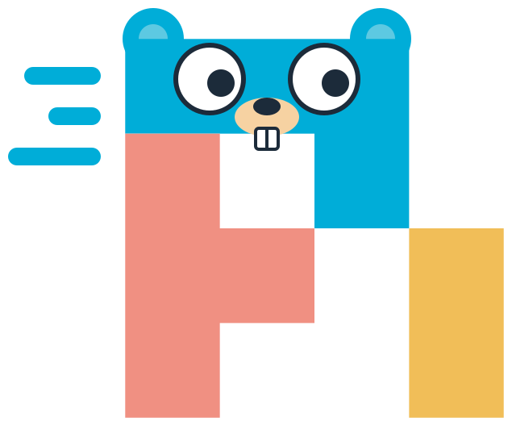
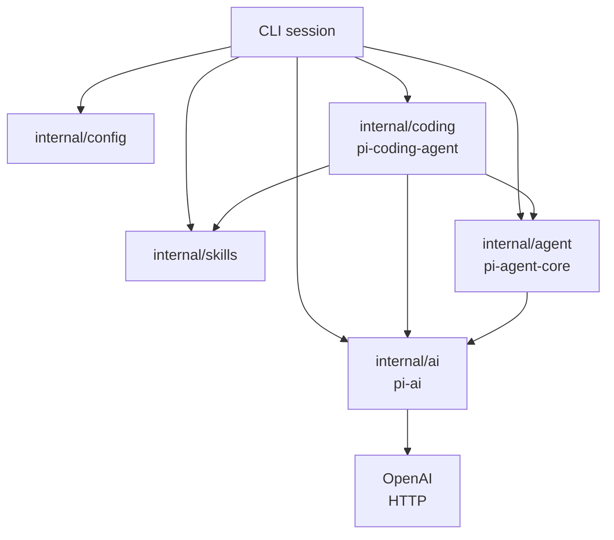
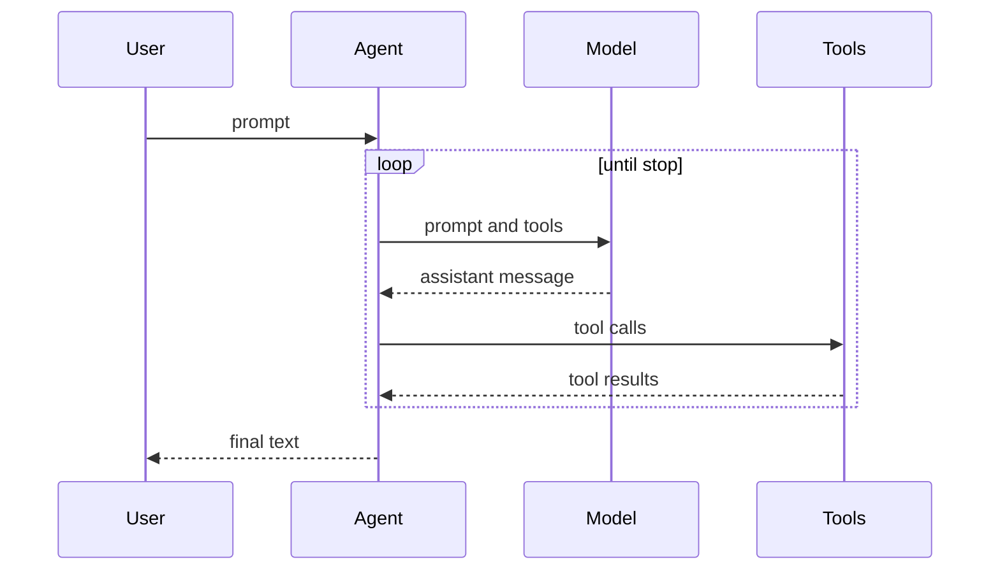

<p align="center"></p>

# pigo

[中文](README.zh-CN.md) · [Design](docs/design.md) · [TUI](docs/tui.md) · [AGENTS.md](AGENTS.md)

pigo is a small Go coding agent. It chats with an OpenAI-compatible model, runs tools, and repeats until the model stops. The layout follows [Pi](https://github.com/earendil-works/pi): model transport, agent loop, and coding session stay in separate packages.

## Design



| Pi package | pigo package | Owns |
| --- | --- | --- |
| `pi-ai` | `internal/ai` | Transcript messages, tool schemas, stream events, HTTP client |
| `pi-agent-core` | `internal/agent` | Agent state, the ask/act loop, tool execution |
| `pi-coding-agent` | `internal/coding` and `internal/cli` | Workspace, coding tools, terminal session |
| skills inside `pi-coding-agent` | `internal/skills` | Find `SKILL.md` files and format the short prompt list |

`internal/ai` describes tools and streams model output. `internal/agent` runs tools and writes results back into the transcript. `internal/coding` supplies the file and shell tools, discovers skills, and keeps writes inside one directory. The longer walkthrough is in [docs/design.md](docs/design.md).

A transcript message is a user message, an assistant message, or a tool result. Assistant text and tool calls sit directly on the assistant message. `wire.go` names the chat-completions JSON, and `encodeRequest` turns tool results into OpenAI `role: "tool"` messages with `json.Marshal`. That conversion is the only place the wire format appears.

### A turn

`Agent.Prompt` is the whole loop:



1. Append the user message.
2. Call the model with the system prompt, the transcript, and the tool schemas.
3. Stream text deltas out for display. The `done` event is the assistant message to store.
4. When the assistant requested tool calls, run them one at a time. Each call is paired with a tool-result message, including failures and cancellation.
5. Go back to step 2 until the assistant stops, the run is canceled, or the turn limit is hit.

The system prompt follows Pi's coding-agent sections: a short preamble, the tool list, the rules, the skill list, and the working directory. It is added when a request is built and is kept out of the stored transcript. `Reset` clears the live transcript and leaves the prompt, model, and tools in place. The conversation is also appended to a session file, described below.

### Workspace

File tools resolve every path from the workspace root, follow symlinks, and reject anything outside that root. `read_file` may also open a discovered skill directory, including `~/.pi/agent/skills`. `write_file` and `edit_file` stay inside the workspace. `run_command` starts `bash` with the workspace as its working directory. Bash is required on Unix.

### Tools

| Tool | Purpose |
| --- | --- |
| `read_file` | Read a UTF-8 file, with line numbers |
| `write_file` | Create or overwrite a file |
| `edit_file` | Replace an exact string once, or everywhere with `replace_all` |
| `list_dir` | List one directory |
| `run_command` | Run a bash command, 30 second timeout |

### Skills

A skill is a directory with a `SKILL.md` file. pigo scans two places, in this order:

1. `~/.pi/agent/skills` (user)
2. `<workspace>/.pi/skills` (project)

A directory that contains `SKILL.md` is one skill. Its subdirectories are not scanned. The same name keeps the first skill, so a user skill overrides a project skill. The prompt receives the name, description, and path. The model loads the file with `read_file` when the task matches. `/skill:name` loads that file immediately and appends an optional request:

```bash
/skill:explain-go main.go
```

This repo includes `.pi/skills/explain-go` and `.pi/skills/go-tests`. `disable-model-invocation: true` hides a skill from the prompt. The command can still run it.

## Usage

Go 1.27 or newer.

```bash
cp .env.example .env
# set OPENAI_API_KEY. PIGO_PROVIDER defaults to openai.

make build
./pigo
```

A terminal opens the chat on the alternate screen. The keys are in [docs/tui.md](docs/tui.md).

- Enter sends. Esc or Ctrl-C cancels the turn. While a turn runs the composer stays editable, and Enter queues one follow-up message (Esc interrupts).
- A denylisted shell command asks before it runs. Enter or `y` allows it, Esc or `n` denies it. `-p` and the line session deny it instead of asking.
- `write_file` and `edit_file` show a diff first, with the same keys. A denial comes back as `blocked:`, and the turn continues. `-p` and the line session deny the change (`blocked: file change needs review`) because they have no screen.
- `--yolo`, `yolo: true`, or `PIGO_YOLO=1` skips both questions. One switch means the session does not ask, so a one-shot edit also skips the command check.
- `/skill:name` loads a skill, `/compact` summarizes older messages, `/reset` clears the live transcript and starts a new session file, and `/exit` quits. `/compact` waits while a turn is running. Auto-compact does the same summary when the estimate passes the reserve. The next turn sends that summary plus the recent tail. How the cut and the session file work is in [docs/design.md](docs/design.md#compaction).
- Quitting leaves the alternate screen. A pipe uses the line session and does not change the screen.

One task, then exit:

```bash
./pigo -p "Create hello.txt that says hi"
# refuses the write; there is no one to ask

./pigo --yolo -p "Create hello.txt that says hi, then read it back"
./pigo -w ~/src/app -p "Summarize the Go files in this directory"
```

Resume the newest session for this workspace, or a specific one:

```bash
./pigo -c
./pigo -c -p "What did we change?"
./pigo --session 550e8400
./pigo --no-session -p "Answer without saving this"
```

Sessions are JSONL files under `~/.pigo/sessions/`, one directory per workspace. The path encoding matches Pi; the directory is pigo's, so the two tools do not open each other's files. How a file is written and loaded is in [docs/design.md](docs/design.md#sessions). `/reset` clears what the model will see next. The previous file stays, and the next prompt creates a new one. `--continue` after a reset with no new prompt still opens the previous file. If the newest file has a bad line in the middle, continue reports that error.

From source:

```bash
make test
make lint
make run
# or
go build -o pigo .
go test ./...
golangci-lint run ./...
go run . -p "List the files here"
```

`make lint` runs [golangci-lint](https://golangci-lint.run/) v2 with `.golangci.yml`. CI runs `go test ./...` and the same lint command.

`make test` includes hermetic end-to-end tests. They talk to a local fake OpenAI-compatible server, so they do not need an API key. `make e2e` runs the live suite against the model in your environment:

```bash
make test
make e2e
# or
go test ./...
go test -tags e2e -count=1 -timeout 15m ./e2e/live/
```

The live tests skip when `OPENAI_API_KEY` or `OPENAI_BASE_URL` is unset. They check files and tool calls, not the model's wording. CI runs them on pushes to `main`, on manual dispatch, and on pull requests from this repository when those secrets exist. Forks skip them.

| Variable | Meaning | Default |
| --- | --- | --- |
| `PIGO_PROVIDER` | Chat backend. `openai` is an OpenAI-compatible chat-completions endpoint | `openai` |
| `OPENAI_API_KEY` | Bearer token when the provider is `openai` | required |
| `OPENAI_BASE_URL` | API root for that provider, usually ending in `/v1` | `https://api.openai.com/v1` |
| `OPENAI_MODEL` | Model name that endpoint accepts | `gpt-5.6-luna` |
| `PIGO_YOLO` | `1` or `true` applies file changes and dangerous shell commands without asking | off |
| `PIGO_SESSION_DIR` | Directory for session files | `~/.pigo/sessions` |
| `PIGO_COMPACT` | `0` or `false` disables auto-compact. `1` or `true` enables it. `/compact` still runs when auto-compact is off | on |
| `PIGO_CONTEXT_WINDOW` | Context budget in tokens | `128000` |
| `PIGO_RESERVE_TOKENS` | Free tokens below that budget | `16384` |
| `PIGO_KEEP_RECENT_TOKENS` | Recent tokens kept verbatim | `20000` |

Flags `--print` (`-p`), `--base-url`, `--model`, `--workspace` (`-w`), `--yolo`, `--continue` (`-c`), `--session`, `--no-session`, and `--session-dir` override the environment. `-c`, `--session`, and `--no-session` cannot be combined. The API key stays out of the flags so it does not land in shell history.

Settings are one flat set: `provider`, `api_key`, `base_url`, `model`, `workspace`, `yolo`, `session_dir`, `compact`, `context_window`, `reserve_tokens`, and `keep_recent_tokens`. A later source wins: built-in defaults, then `~/.pigo/config.yaml`, then `./pigo.yaml`, then `.env` in the current directory, then the environment, then flags. An absent `--yolo` does not turn a file's `yolo: true` back off. `session_dir` is optional; an empty value uses `~/.pigo/sessions`.

```yaml
provider: openai
api_key: sk-...
base_url: https://api.openai.com/v1
model: gpt-5.6-luna
workspace: .
```

A one-shot run prints the same stream the chat shows. Without `--yolo` a file change stops before it writes:

```text
→ write_file {"path":"hello.txt","content":"hi"}
✗ blocked: file change needs review
```

`--yolo` applies it:

```text
→ write_file {"path":"hello.txt","content":"hi"}
← wrote hello.txt (2 bytes)
Created hello.txt.
120 in · 40 out
```

Each request sets `stream_options.include_usage`. Calls that report usage add up to a session total. The chat status line shows that total as `1.2K in · 340 out` and stays blank when the provider sends none. `-p` prints one line, such as `120 in · 40 out`, only for a call that reported usage. The transcript is saved. The counts are not, and a resumed session starts them over. pigo does not price them.

## Out of scope

A full Pi TUI, native APIs for every model vendor, a skills marketplace, ignore-file filtering, session branching, the session picker, compaction, sub-agents, and telemetry. The turn limit is 25 model calls.
