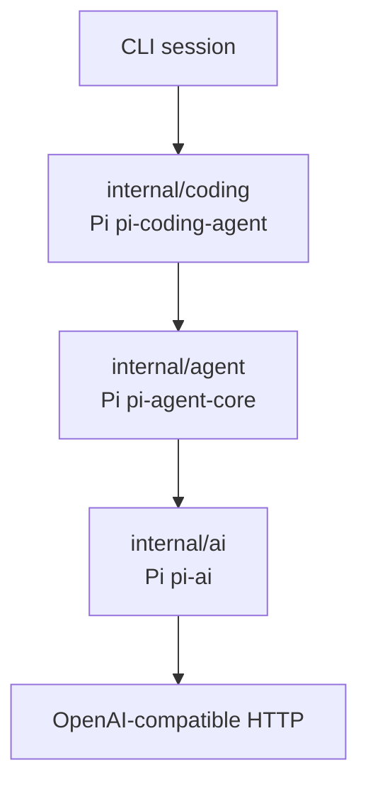
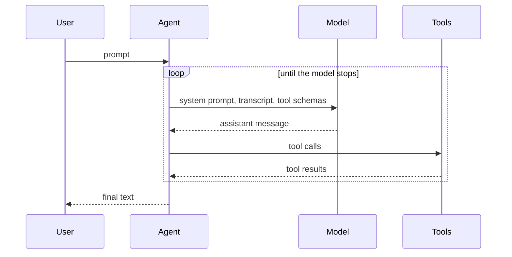

# pigo

pigo is a small Go coding agent. It chats with an OpenAI-compatible model, runs tools, and repeats until the model stops. The layout follows [Pi](https://github.com/earendil-works/pi): model transport, agent loop, and coding session stay in separate packages.

## Design



| Pi package | pigo package | Owns |
| --- | --- | --- |
| `pi-ai` | `internal/ai` | Transcript messages, tool schemas, stream events, HTTP client |
| `pi-agent-core` | `internal/agent` | Agent state, the ask/act loop, tool execution |
| `pi-coding-agent` | `internal/coding` and `internal/cli` | Workspace, coding tools, terminal session |

`internal/ai` describes tools and streams model output. `internal/agent` runs tools and writes results back into the transcript. `internal/coding` supplies the file and shell tools and keeps paths inside one directory.

A transcript message is a user message, an assistant message, or a tool result. Assistant text and tool calls sit directly on the assistant message. The HTTP client turns tool results into OpenAI `role: "tool"` messages. That conversion is the only place the wire format appears.

### A turn

`Agent.Prompt` is the whole loop:



1. Append the user message.
2. Call the model with the system prompt, the transcript, and the tool schemas.
3. Stream text deltas out for display. The `done` event is the assistant message to store.
4. When the assistant requested tool calls, run them one at a time. Each call is paired with a tool-result message, including failures and cancellation.
5. Go back to step 2 until the assistant stops, the run is canceled, or the turn limit is hit.

The system prompt follows Pi's coding-agent sections: a short preamble, the tool list, the rules, and the working directory. It is added when a request is built and is kept out of the stored transcript. `Reset` clears the transcript and leaves the prompt, model, and tools in place.

### Workspace

File tools resolve every path from the workspace root, follow symlinks, and reject anything outside that root. `run_command` starts a shell with that directory as its working directory. The shell is an ordinary process: file confinement applies to the file tools.

### Tools

| Tool | Purpose |
| --- | --- |
| `read_file` | Read a UTF-8 file, with line numbers |
| `write_file` | Create or overwrite a file |
| `edit_file` | Replace an exact string once, or everywhere with `replace_all` |
| `list_dir` | List one directory |
| `run_command` | Run a shell command, 30 second timeout |

## Usage

Go 1.27 or newer.

```bash
cp .env.example .env
# set OPENAI_API_KEY. PIGO_PROVIDER defaults to openai.

make build
./pigo
```

A terminal opens a chat screen. Type a task, press enter, and watch the reply stream. Tool calls print on their own lines. `/reset` clears the transcript, `/exit` quits, and Ctrl-C cancels the task in progress. Page Up and Page Down scroll the transcript.

When stdin is not a terminal, the same commands work as a line session. That is what pipes and tests use.

One task, then exit:

```bash
./pigo -p "Create hello.txt that says hi, then read it back"
./pigo -w ~/src/app -p "Summarize the Go files in this directory"
```

From source:

```bash
make test
make run
# or
go build -o pigo .
go test ./...
go run . -p "List the files here"
```

| Variable | Meaning | Default |
| --- | --- | --- |
| `PIGO_PROVIDER` | Chat backend. `openai` is an OpenAI-compatible chat-completions endpoint | `openai` |
| `OPENAI_API_KEY` | Bearer token when the provider is `openai` | required |
| `OPENAI_BASE_URL` | API root for that provider, usually ending in `/v1` | `https://api.openai.com/v1` |
| `OPENAI_MODEL` | Model name that endpoint accepts | `gpt-4o-mini` |

Flags `-base-url`, `-model`, and `-w` override the environment. The API key stays in the environment so it does not land in shell history. A `.env` file in the current directory fills in variables that are not already set.

A one-shot run prints the same stream the chat shows:

```text
→ write_file {"path":"hello.txt","content":"hi"}
← wrote hello.txt (2 bytes)
Created hello.txt.
```

## Out of scope

A full Pi TUI, native APIs for every model vendor, a skills catalog, session files on disk, sub-agents, and telemetry. The turn limit is 25 model calls.
