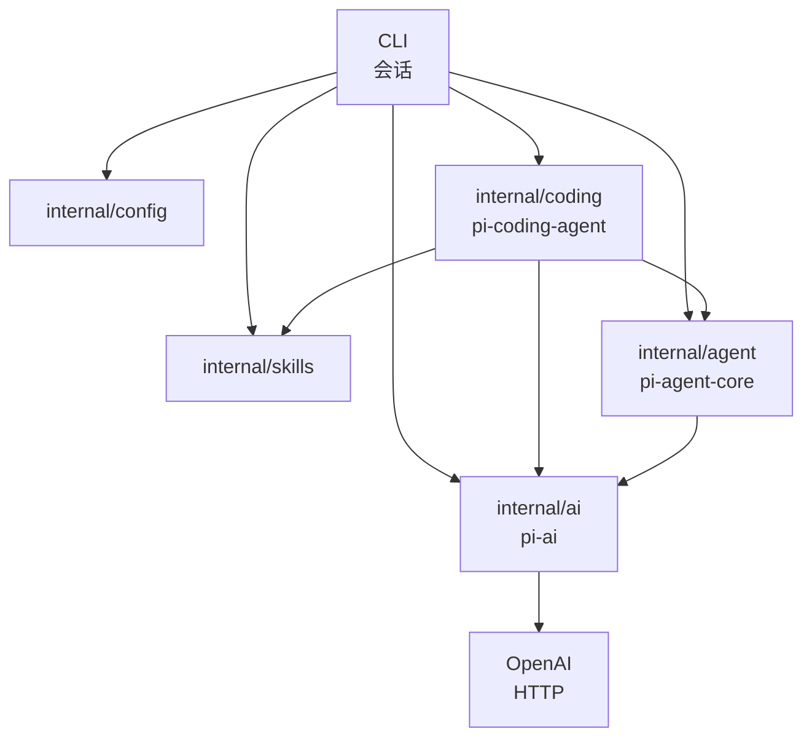
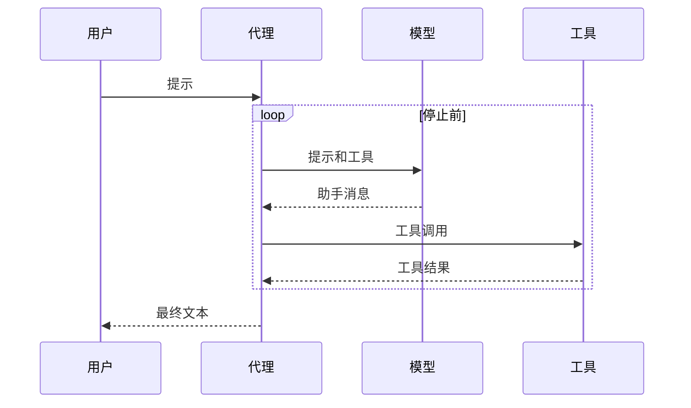

<p align="center"></p>

# pigo

[English](README.md) · [设计说明](docs/design.zh-CN.md) · [界面](docs/tui.zh-CN.md) · [AGENTS.md](AGENTS.md)

pigo 是一个小型 Go 编码代理。它和一个兼容 OpenAI 的模型对话，调用工具，然后重复，直到模型停止。目录划分跟随 [Pi](https://github.com/earendil-works/pi)：模型传输、代理循环、编码会话各自独立。

## 设计



| Pi 包 | pigo 包 | 负责 |
| --- | --- | --- |
| `pi-ai` | `internal/ai` | 会话消息、工具 schema、流式事件、HTTP 客户端 |
| `pi-agent-core` | `internal/agent` | 代理状态、询问再行动的循环、工具执行 |
| `pi-coding-agent` | `internal/coding` 和 `internal/cli` | 工作区、编码工具、终端会话 |
| `pi-coding-agent` 里的 skills | `internal/skills` | 查找 `SKILL.md`，并生成提示词里的简短列表 |

`internal/ai` 描述工具并接收模型输出。`internal/agent` 执行工具，把结果写回会话记录。`internal/coding` 提供文件和 shell 工具、发现技能，并把写入限制在一个目录里。更完整的讲解在 [docs/design.zh-CN.md](docs/design.zh-CN.md)。

一条会话记录是用户消息、助手消息，或工具结果。助手的文本和工具调用直接放在助手消息上。`wire.go` 写出 chat-completions 的 JSON 形状，`encodeRequest` 用 `json.Marshal` 把工具结果转成 OpenAI 的 `role: "tool"`。只有这一处出现线路格式。

### 一轮

`Agent.Prompt` 就是整个循环：



1. 追加用户消息。
2. 把系统提示、会话记录和工具 schema 发给模型。
3. 把文本增量流式显示出来。`done` 事件才是要保存的助手消息。
4. 如果助手请求了工具，就逐个执行。每次调用都配一条工具结果，失败和取消也一样。
5. 回到第 2 步，直到助手停止、运行被取消，或达到轮数上限。

系统提示沿用 Pi coding-agent 的分节：简短开场、工具列表、规则、技能列表、工作目录。它在构造请求时附上，不写入保存的会话记录。`Reset` 清空当前会话记录，提示、模型和工具保留。对话也会追加到会话文件里，见下面的用法。

### 工作区

文件工具从工作区根目录解析路径，跟随符号链接，并拒绝根目录之外的目标。`read_file` 还可以打开已发现的技能目录，包括 `~/.pi/agent/skills`。`write_file` 和 `edit_file` 仍限制在工作区内。`run_command` 以工作区为当前目录启动 `bash`。Unix 上需要安装 bash。

### 工具

| 工具 | 作用 |
| --- | --- |
| `read_file` | 读取 UTF-8 文件，并带上行号 |
| `write_file` | 创建或覆盖文件 |
| `edit_file` | 精确替换一次字符串；`replace_all` 时替换全部 |
| `list_dir` | 列出一个目录 |
| `run_command` | 运行 bash 命令，超时 30 秒 |

### 技能

一个技能是含有 `SKILL.md` 的目录。pigo 按这个顺序扫描两处：

1. `~/.pi/agent/skills`（用户）
2. `<工作区>/.pi/skills`（项目）

含有 `SKILL.md` 的目录就是一个技能，不再扫描它的子目录。同名时保留先发现的那个，所以用户技能覆盖项目技能。提示词只收到名称、描述和路径。任务匹配时，模型用 `read_file` 读取文件。`/skill:name` 会立刻装入该文件，并可附上一段请求：

```bash
/skill:explain-go main.go
```

本仓库带有 `.pi/skills/explain-go` 和 `.pi/skills/go-tests`。前置信息里的 `disable-model-invocation: true` 会把技能从提示词中隐藏。命令仍然可以运行它。

## 用法

需要 Go 1.27 或更新版本。

```bash
cp .env.example .env
# 设置 OPENAI_API_KEY。PIGO_PROVIDER 默认是 openai。

make build
./pigo
```

终端在备用屏幕上打开聊天。按键见 [docs/tui.zh-CN.md](docs/tui.zh-CN.md)。

- Enter 发送。Esc 或 Ctrl-C 取消这一轮。这一轮进行中输入条仍可编辑，Enter 会排成一条后续消息（Esc 打断）。
- 拒绝表上的 shell 命令会先询问。Enter 或 `y` 允许，Esc 或 `n` 拒绝。`-p` 和逐行会话不询问，直接拒绝。
- `write_file` 和 `edit_file` 会先给出 diff，按键相同。拒绝后工具结果是 `blocked:`，这一轮继续。`-p` 和逐行会话没有画面，所以拒绝这次改动（`blocked: file change needs review`）。
- `--yolo`、`yolo: true` 或 `PIGO_YOLO=1` 跳过这两次询问。一个开关表示不再询问，所以单次编辑也会跳过命令检查。
- `/skill:name` 装入技能，`/compact` 摘要更早的消息，`/reset` 清空当前会话记录并开始一个新的会话文件，`/exit` 退出。这一轮还在跑时 `/compact` 会等待。估计超过预留时，自动压缩做同样的摘要。下一轮发送这份摘要和最近的尾巴。切分和会话文件见 [docs/design.zh-CN.md](docs/design.zh-CN.md#上下文压缩)。
- 退出会离开备用屏幕。管道走逐行会话，不改屏幕。

做完一个任务后退出：

```bash
./pigo -p "Create hello.txt that says hi"
# 拒绝写入；没有人可以询问

./pigo --yolo -p "Create hello.txt that says hi, then read it back"
./pigo -w ~/src/app -p "Summarize the Go files in this directory"
```

恢复这个工作区最新的会话，或指定一个：

```bash
./pigo -c
./pigo -c -p "What did we change?"
./pigo --session 550e8400
./pigo --no-session -p "Answer without saving this"
```

会话是 `~/.pigo/sessions/` 下的 JSONL 文件，每个工作区一个目录。路径编码和 Pi 相同；目录是 pigo 自己的，所以两个工具不会打开对方的文件。文件如何写入和读取见 [docs/design.zh-CN.md](docs/design.zh-CN.md#会话文件)。`/reset` 清掉模型下一次会看到的内容。原来的文件还在，下一条提示才新建文件。reset 之后如果没有新的提示，`--continue` 仍会打开原来的文件。

从源码运行：

```bash
make test
make lint
make run
# 或者
go build -o pigo .
go test ./...
golangci-lint run ./...
go run . -p "List the files here"
```

`make lint` 用 `.golangci.yml` 运行 [golangci-lint](https://golangci-lint.run/) v2。CI 运行 `go test ./...` 和同一条 lint 命令。

`make test` 包含不联网的端到端测试。它们对着本机的假 OpenAI 兼容服务跑，不需要 API 密钥。`make e2e` 用当前环境里的模型跑真实端到端测试：

```bash
make test
make e2e
# 或者
go test ./...
go test -tags e2e -count=1 -timeout 15m ./e2e/live/
```

没有 `OPENAI_API_KEY` 或 `OPENAI_BASE_URL` 时，真实测试会跳过。它们检查写出的文件和工具调用，不检查模型的原话。CI 在推送到 `main`、手动触发，以及本仓库自己的 pull request 上运行；密钥不存在时跳过，fork 不会拿到密钥。

| 变量 | 含义 | 默认值 |
| --- | --- | --- |
| `PIGO_PROVIDER` | 聊天后端。`openai` 表示兼容 OpenAI 的 chat-completions 接口 | `openai` |
| `OPENAI_API_KEY` | 提供者是 `openai` 时的令牌 | 必填 |
| `OPENAI_BASE_URL` | 该提供者的 API 根，通常以 `/v1` 结尾 | `https://api.openai.com/v1` |
| `OPENAI_MODEL` | 该接口接受的模型名 | `gpt-5.6-luna` |
| `PIGO_YOLO` | 设为 `1` 或 `true` 时，文件改动和危险 shell 命令都不再询问 | 关闭 |
| `PIGO_SESSION_DIR` | 会话文件所在目录 | `~/.pigo/sessions` |
| `PIGO_COMPACT` | `0` 或 `false` 关闭自动压缩。`1` 或 `true` 打开。自动压缩关闭时 `/compact` 仍可运行 | 打开 |
| `PIGO_CONTEXT_WINDOW` | 上下文预算，单位是 token | `128000` |
| `PIGO_RESERVE_TOKENS` | 预算下方留出的 token | `16384` |
| `PIGO_KEEP_RECENT_TOKENS` | 原样保留的最近 token | `20000` |

`--print`（`-p`）、`--base-url`、`--model`、`--workspace`（`-w`）、`--yolo`、`--continue`（`-c`）、`--session`、`--no-session` 和 `--session-dir` 覆盖环境变量。`-c`、`--session` 和 `--no-session` 不能一起用。API 密钥不做成命令行参数，避免进 shell 历史。

配置是一组扁平字段：`provider`、`api_key`、`base_url`、`model`、`workspace`、`yolo`、`session_dir`、`compact`、`context_window`、`reserve_tokens`、`keep_recent_tokens`。后出现的来源胜出：内置默认值，然后是 `~/.pigo/config.yaml`，然后是 `./pigo.yaml`，然后是当前目录的 `.env`，然后是环境变量，最后是命令行参数。没有传 `--yolo` 时，不会把文件里的 `yolo: true` 改回关闭。`session_dir` 可以不写；空着就用 `~/.pigo/sessions`。

```yaml
provider: openai
api_key: sk-...
base_url: https://api.openai.com/v1
model: gpt-5.6-luna
workspace: .
```

单次运行打印的流和聊天画面相同。没有 `--yolo` 时，文件改动在写入之前停下：

```text
→ write_file {"path":"hello.txt","content":"hi"}
✗ blocked: file change needs review
```

`--yolo` 会把它写下去：

```text
→ write_file {"path":"hello.txt","content":"hi"}
← wrote hello.txt (2 bytes)
Created hello.txt.
120 in · 40 out
```

每次请求都会带上 `stream_options.include_usage`。报告了用量的调用累加成会话合计。聊天状态栏把这个合计显示成 `1.2K in · 340 out`；提供方没有给用量时留空。`-p` 只在某次调用带了用量时打一行，例如 `120 in · 40 out`。会话记录会保存。用量不保存，恢复后合计从头算。pigo 也不计价。

## 不做的事

完整的 Pi TUI、各家模型的原生 API、技能市场、忽略文件过滤、会话分支、会话选择器、压缩、子代理，以及遥测。轮数上限是 25 次模型调用。
