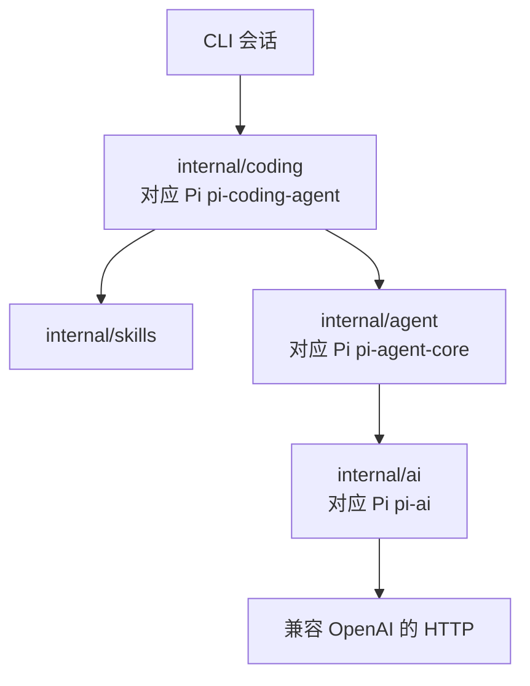
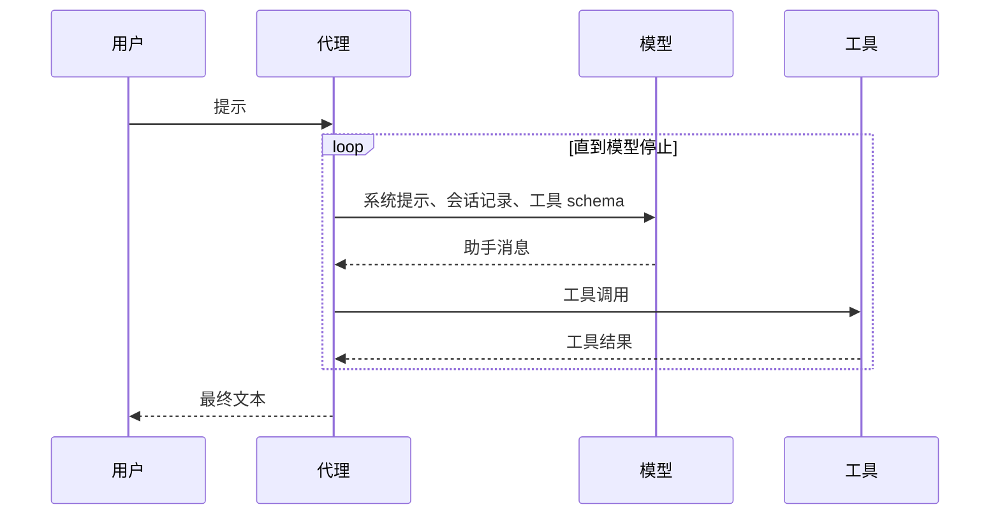

<p align="center"></p>

# pigo

[English](README.md) · [设计说明](docs/design.zh-CN.md)

pigo 是一个小型 Go 编码代理。它和一个兼容 OpenAI 的模型对话，调用工具，然后重复，直到模型停止。目录划分跟随 [Pi](https://github.com/earendil-works/pi)：模型传输、代理循环、编码会话各自独立。

## 设计



| Pi 包 | pigo 包 | 负责 |
| --- | --- | --- |
| `pi-ai` | `internal/ai` | 会话消息、工具 schema、流式事件、HTTP 客户端 |
| `pi-agent-core` | `internal/agent` | 代理状态、询问再行动的循环、工具执行 |
| `pi-coding-agent` | `internal/coding` 和 `internal/cli` | 工作区、编码工具、终端会话 |
| `pi-coding-agent` 里的 skills | `internal/skills` | 查找 `SKILL.md`，并生成提示词里的简短列表 |

`internal/ai` 描述工具并接收模型输出。`internal/agent` 执行工具，把结果写回会话记录。`internal/coding` 提供文件和 shell 工具、发现技能，并把写入限制在一个目录里。更完整的讲解在 [docs/design.zh-CN.md](docs/design.zh-CN.md)。

一条会话记录是用户消息、助手消息，或工具结果。助手的文本和工具调用直接放在助手消息上。HTTP 客户端把工具结果转成 OpenAI 的 `role: "tool"`。只有这一处出现线路格式。

### 一轮

`Agent.Prompt` 就是整个循环：



1. 追加用户消息。
2. 把系统提示、会话记录和工具 schema 发给模型。
3. 把文本增量流式显示出来。`done` 事件才是要保存的助手消息。
4. 如果助手请求了工具，就逐个执行。每次调用都配一条工具结果，失败和取消也一样。
5. 回到第 2 步，直到助手停止、运行被取消，或达到轮数上限。

系统提示沿用 Pi coding-agent 的分节：简短开场、工具列表、规则、技能列表、工作目录。它在构造请求时附上，不写入保存的会话记录。`Reset` 清空会话记录，提示、模型和工具保留。

### 工作区

文件工具从工作区根目录解析路径，跟随符号链接，并拒绝根目录之外的目标。`read_file` 还可以打开已发现的技能目录，包括 `~/.pi/agent/skills`。`write_file` 和 `edit_file` 仍限制在工作区内。`run_command` 以工作区为当前目录启动 shell。

### 工具

| 工具 | 作用 |
| --- | --- |
| `read_file` | 读取 UTF-8 文件，并带上行号 |
| `write_file` | 创建或覆盖文件 |
| `edit_file` | 精确替换一次字符串；`replace_all` 时替换全部 |
| `list_dir` | 列出一个目录 |
| `run_command` | 运行 shell 命令，超时 30 秒 |

### 技能

一个技能是含有 `SKILL.md` 的目录。pigo 按这个顺序扫描两处：

1. `~/.pi/agent/skills`（用户）
2. `<工作区>/.pi/skills`（项目）

含有 `SKILL.md` 的目录就是一个技能，不再扫描它的子目录。同名时保留先发现的那个，所以用户技能覆盖项目技能。提示词只收到名称、描述和路径。任务匹配时，模型用 `read_file` 读取文件。`/skill:name` 会立刻装入该文件，并可附上一段请求：

```bash
/skill:explain-go main.go
```

本仓库带有 `.pi/skills/explain-go` 和 `.pi/skills/go-tests`。前置信息里的 `disable-model-invocation: true` 会把技能从提示词中隐藏。命令仍然可以运行它。

## 用法

需要 Go 1.27 或更新版本。

```bash
cp .env.example .env
# 设置 OPENAI_API_KEY。PIGO_PROVIDER 默认是 openai。

make build
./pigo
```

在终端里会打开聊天画面。输入任务并回车，回复会流式出现。工具调用各自占一行。`/skill:name` 装入技能，`/reset` 清空会话，`/exit` 退出，Ctrl-C 取消正在进行的任务。Page Up 和 Page Down 滚动记录。

标准输入不是终端时，同样的命令走逐行会话。管道和测试用的就是这条路径。

做完一个任务后退出：

```bash
./pigo -p "Create hello.txt that says hi, then read it back"
./pigo -w ~/src/app -p "Summarize the Go files in this directory"
```

从源码运行：

```bash
make test
make lint
make run
# 或者
go build -o pigo .
go test ./...
golangci-lint run ./...
go run . -p "List the files here"
```

`make lint` 用 `.golangci.yml` 运行 [golangci-lint](https://golangci-lint.run/) v2。CI 运行 `go test ./...` 和同一条 lint 命令。

| 变量 | 含义 | 默认值 |
| --- | --- | --- |
| `PIGO_PROVIDER` | 聊天后端。`openai` 表示兼容 OpenAI 的 chat-completions 接口 | `openai` |
| `OPENAI_API_KEY` | 提供者是 `openai` 时的令牌 | 必填 |
| `OPENAI_BASE_URL` | 该提供者的 API 根，通常以 `/v1` 结尾 | `https://api.openai.com/v1` |
| `OPENAI_MODEL` | 该接口接受的模型名 | `gpt-4o-mini` |

`-base-url`、`-model` 和 `-w` 覆盖环境变量。API 密钥只放在环境里，避免进 shell 历史。当前目录的 `.env` 只填补尚未设置的变量。

单次运行打印的流和聊天画面相同：

```text
→ write_file {"path":"hello.txt","content":"hi"}
← wrote hello.txt (2 bytes)
Created hello.txt.
```

## 不做的事

完整的 Pi TUI、各家模型的原生 API、技能市场、忽略文件过滤、磁盘上的会话文件、子代理，以及遥测。轮数上限是 25 次模型调用。
