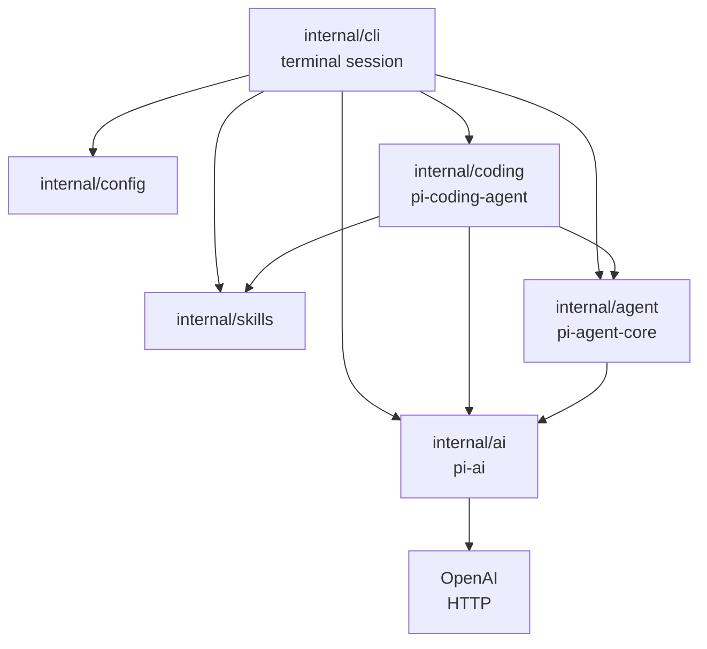
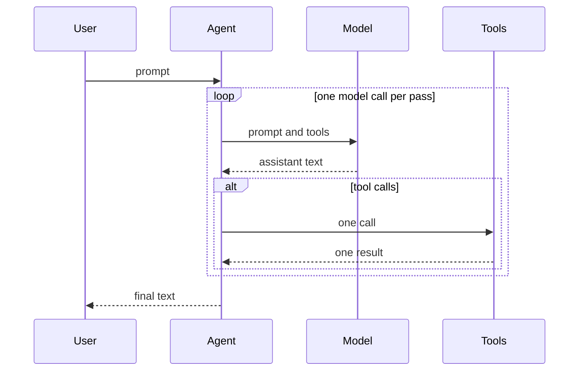
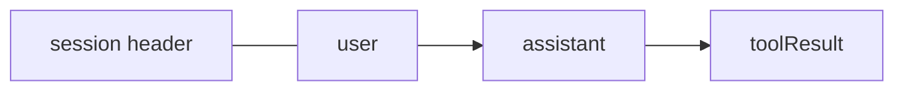
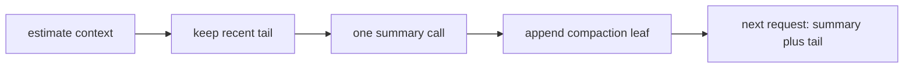
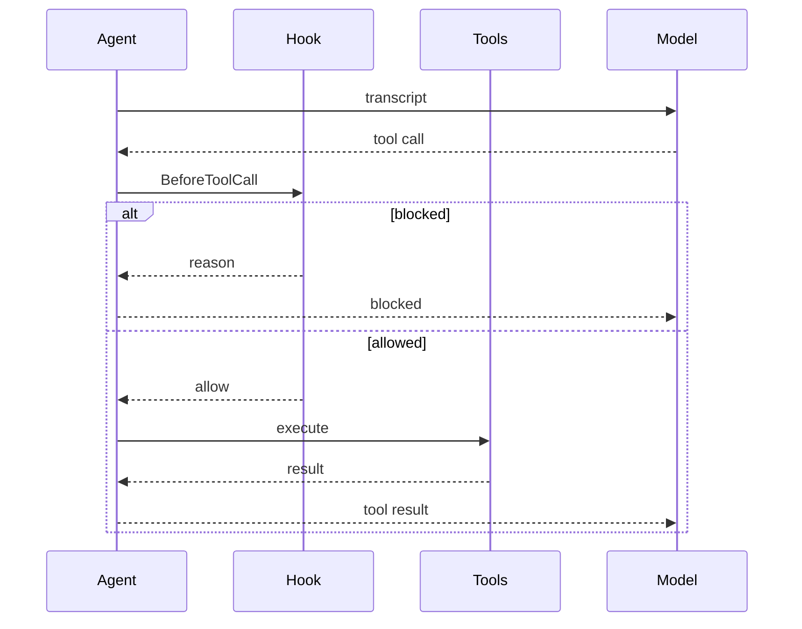
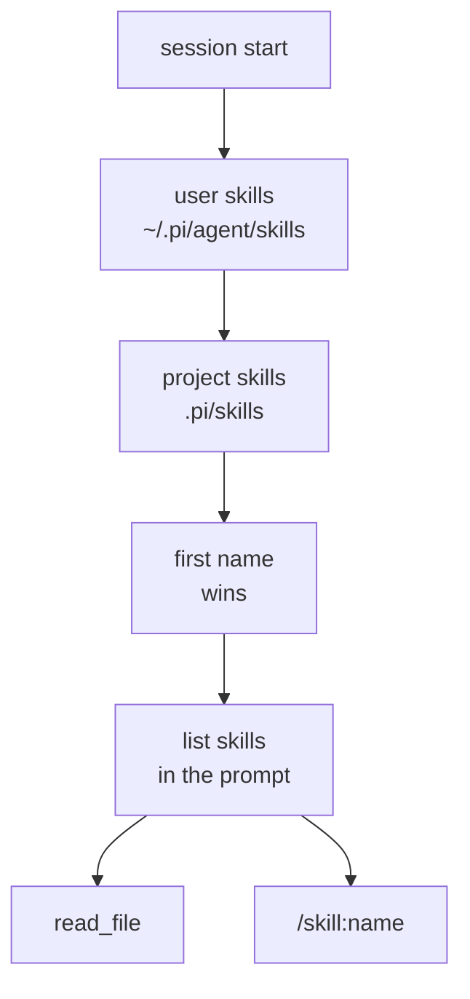

# How pigo follows Pi

[中文](design.zh-CN.md) · [TUI](tui.md) · [README](../README.md)

pigo is a small Go program for reading [Pi](https://github.com/earendil-works/pi)'s core ideas. It keeps the same three layers and leaves out the marketplace, extensions, and full TUI.

## Three layers



| Layer | May know about | Must not know about |
| --- | --- | --- |
| `internal/ai` | Messages, tool schemas, streaming, HTTP | Running a tool, files, the loop |
| `internal/agent` | Transcript, the ask/act loop, calling `Tool.Execute` | HTTP, workspaces, skills |
| `internal/coding` | Workspace, file and shell tools, the system prompt | How SSE is parsed |
| `internal/skills` | Where `SKILL.md` lives, the short prompt list | The loop and HTTP |
| `internal/config` | Flags, environment, `.env`, YAML | The loop, HTTP, and the screen |
| `internal/cli` | Cobra, Bubble Tea, `/skill:name`, calling `config.Load` | Path checks and the wire format |

A skill never becomes a new agent type. The coding session discovers skills and either mentions them in the system prompt or, for `/skill:name`, pastes the file into an ordinary user message. `Agent.Prompt` still only sees messages and tools.

## Transcript and wire format

The transcript is the memory of the loop. A message has a role, text, and for the assistant a list of tool calls. A tool result is its own role, `toolResult`, and carries the tool-call ID it answers.

OpenAI chat completions use a different shape: tool calls are nested under `function`, and a tool result is `role: "tool"`. `wire.go` names one Go type per JSON object. `encodeRequest` writes the request, and the accumulator reads each `wireChunk`, both through `json.Marshal` and `json.Unmarshal`. The rest of the program keeps the flatter transcript.

The system prompt is attached when a request is built. It is not stored in the transcript, so `Reset` can drop messages and leave the prompt, model, and tools in place. The on-disk session in [Sessions](#sessions) follows that rule: the file holds the conversation, and the prompt is rebuilt for the next request.

A streaming request sets `stream_options.include_usage`. When a chunk includes `usage`, the accumulator keeps the latest object: `prompt_tokens` or `input_tokens`, `completion_tokens` or `output_tokens`, and `total_tokens` when the provider sent it. Counts from one call are not added together. Each reported call is added into a session total held in memory, and `Reset` drops that total with the transcript. The status line shows the total the way Codex does (`1.2K in · 340 out`) and leaves the segment out when the provider sends nothing. `-p` and the line session print one line for a call that reported usage. Those counts are not written to the session file, and there is no price table.

## The agent loop



One pass of `run` is one model call. Text deltas are for the screen. The `done` event is the assistant message stored in the transcript.

If that message has tool calls, each call is executed and paired with a `toolResult` that reuses the call ID. The next pass sends both. A call that is canceled or unknown still gets a result. An assistant message with an unpaired tool call would make the next request invalid.

The turn limit is 25 model calls.

## Sessions

pigo appends the transcript to a JSONL file. The shape follows [Pi's session format](https://pi.dev/docs/latest/session-format): one JSON object per line, a header first, then entries linked by `id` and `parentId`. pigo only appends to the current leaf, so a file it writes is a single chain. Load still walks from the last line back to the root. That path is what the model sees. A side branch stays in the file and is not sent. There is no tree UI.



Files live under `~/.pigo/sessions/`, one directory per workspace:

```text
~/.pigo/sessions/--tmp-project--/2026-10-19T17-40-00-000Z_<uuid>.jsonl
```

The directory name is the workspace path with one leading separator removed and `/`, `\`, and `:` turned into `-`, then wrapped in `--`. That encoding is Pi's. The root is `~/.pigo/sessions`, not `~/.pi/agent/sessions`. pigo writes a subset of Pi's entries, and a file in Pi's directory would be something Pi tries to open. `PIGO_SESSION_DIR`, `session_dir` in a config file, or `--session-dir` selects another root. The directory is created as `0700` and each file as `0600`, because a transcript can hold source and command output.

The file is created on the first user message. Quitting without a prompt leaves no file. Each later message is one appended line, synced before the turn goes on. A crash can tear the last line. Load drops a trailing partial line and keeps the complete ones. A bad line in the middle is an error, so a short read is not mistaken for the whole session.

```json
{"type":"session","version":3,"id":"550e8400-e29b-41d4-a716-446655440000","timestamp":"2026-10-19T17:40:00.000Z","cwd":"/tmp/project"}
{"type":"message","id":"a1b2c3d4","parentId":null,"timestamp":"2026-10-19T17:40:01.000Z","message":{"role":"user","content":"hello","timestamp":1760895601000}}
{"type":"message","id":"b2c3d4e5","parentId":"a1b2c3d4","timestamp":"2026-10-19T17:40:02.000Z","message":{"role":"assistant","content":[{"type":"text","text":"hi"}],"model":"gpt-5.6-luna","stopReason":"stop","timestamp":1760895602000}}
```

Version 3 is Pi's current header. Assistant text and tool calls use Pi's content blocks (`text`, `toolCall`). A tool result uses `role: "toolResult"`. The in-memory message stays flat. This conversion is the edge of the file. The system prompt is not a line in the file. A `system` message found there is skipped, and the live prompt is attached when the request is built. Entry types other than `message` are skipped as transcript lines, including `usage` and `label`. A `compaction` entry on the leaf is applied, as described in [Compaction](#compaction). A version 1 file with no `parentId` links is read in file order.

A tool call with no stored result is dropped on load, and so is a tool result with no call. The file is not rewritten. The next request stays valid when a tool pair was torn.

| Flag | Effect |
| --- | --- |
| `-c`, `--continue` | Open the newest file for this workspace. If there is none, start a new session. |
| `--session <path\|id>` | Open a JSONL path, an exact id, or a unique id prefix in this workspace's directory. |
| `--no-session` | Keep the transcript in memory. Read nothing and write nothing. |
| `--session-dir` | Sessions root. Overrides `PIGO_SESSION_DIR` and `session_dir`. |

`-c`, `--session`, and `--no-session` cannot be combined. The chat and `-p` both resume. `-p` and the line session print `resumed <id> (N messages)` when the file had messages. The chat draws those messages before the first prompt. The model request is the current system prompt, then the leaf path, then the new user message. When the leaf has a compaction entry, the path is replaced by the summary plus the messages from `firstKeptEntryId` forward. The stored messages are still the full leaf. Resume keeps the model you start with. Assistant lines record the model that wrote them.

`/reset` clears the live transcript and the in-memory token total, and the screen prints a separator. The lines above that separator stay. The previous file stays too. When a file existed, the line session prints `previous session <id>`. The next prompt creates a new file. `--continue` after a reset that sent no new prompt still opens the previous file, because the new file does not exist yet. Token counts are not in the file. After a resume or a reset they start again when the provider reports usage.

Deleting a session is deleting its `.jsonl` file.

A session picker, display names, branching, forking, and context edits are left out. The leaf walk is here because a file with a branch must still load the path the next request will send. Compaction entries on that path are applied; a summary on a side branch is not.

| Topic | Choice | Alternative | Why |
| --- | --- | --- | --- |
| Directory | `~/.pigo/sessions` with Pi's path encoding | `~/.pi/agent/sessions` | The layout is recognizable. The files are a subset, so they stay out of Pi's directory |
| Shape | Header plus `id` / `parentId` messages | A private transcript dump | Load can walk a leaf. The writer only appends, which keeps the code short |
| Prompt | Rebuilt on each request | Store Pi system messages | The agent already keeps the prompt out of the transcript. Skills can change between runs |
| Counts | Stay in memory | Write Pi usage entries | Usage is already shown for this process. Resume starts the total over |
| `/reset` | New file, old file kept | Truncate the current file | Append-only matches the format. The old conversation can be opened with `--session` |
| Compaction | Append a summary leaf | Rewrite the file | Raw messages stay. Resume sends the summary and the tail |

## Compaction

Auto-compact runs when the estimated context is greater than `context_window - reserve_tokens`. `/compact` does the same thing on demand, and an optional argument focuses the summary (`/compact The Parser`). The summary is one user message on the next model call. It is not stored as a transcript message, and it is not painted as an assistant reply.

The estimate prefers the last chat call's provider usage, plus about four characters per token for messages added since that call. Without usage, the same character estimate covers the system prompt and the messages the next call would send. Tool schemas are left in the reserve. A summary call's usage is added to the session total and does not become the new anchor, because that call measured the summarization prompt. Compaction clears the anchor, because the old count included messages the next request will not send.

The cut walks backward until `keep_recent_tokens` and lands on a user or assistant message. A tool result stays with the call that produced it. If the tail already fits, auto-compact sends the request unchanged. `/compact` then reports `nothing to compact`. `keep_recent_tokens` should stay below `context_window - reserve_tokens`. There is no model catalog, so the window is a setting. The defaults are compact on, a window of 128000, a reserve of 16384, and 20000 recent tokens. An estimate equal to the line does not compact.

The summary request uses the same stream and sends no tools. The prompt asks for Pi's sections: Goal, Constraints & Preferences, Progress, Key Decisions, Next Steps, Critical Context. A later compact updates the previous summary instead of starting over. Paths from `read_file` are listed under `<read-files>`, and paths from `write_file` and `edit_file` under `<modified-files>`. Failure leaves the context unchanged. Auto-compact then stops the turn. `/compact` returns the error. Esc cancels the summary call.

When a session file is open, the summary is one more appended line and becomes the leaf. `firstKeptEntryId` is the file id of the first message that stays verbatim. The messages it replaces stay in the file. The next message's `parentId` is the compaction id. Load walks the leaf, keeps every surviving message in the transcript, and sends the summary plus the messages from that id forward, including messages written after the entry. If the id is missing, the kept tail is whatever survived after the compaction entry. A message that never reached the file keeps an empty slot, so later lines stay at the same index. Compaction will not record a kept boundary that was never written, and the in-memory summary is rolled back. If the id names a tool result, the tail starts at the assistant that produced it. A tool result with no call is not sent. `/reset` drops the in-memory summary and starts a new file.

File review is unchanged. Compaction runs before the model call. `write_file` and `edit_file` still go through `BeforeToolCall`.



| Topic | Choice | Alternative | Why |
| --- | --- | --- | --- |
| Trigger | Estimate past the reserve, or `/compact` | Compact every turn | The recent window stays verbatim until the budget is actually tight |
| Cut | One summary, tool pairs stay together | Two summaries when a turn is split | One call is enough to read. A split turn is summarized whole |
| File | Append the summary, keep the raw lines | Rewrite the file down to the tail | Resume can still show the old messages. The leaf walk picks the summary |
| Left out | Branch summaries, overflow retry, extensions, pricing | A second compaction agent | Those need a tree UI or a model catalog this tree does not have |

## Dangerous commands

The agent core does not decide which commands are safe. `BeforeToolCall` runs after the model asks for a tool and before `Execute`. The hook can allow the call, block it, or replace its arguments. A blocked call still gets a tool result, so the turn continues and the model can adapt.



`internal/coding` is the only place that names dangerous shell commands. It matches `run_command` against a short denylist. Options may follow a path (`rm ~ -rf`); words after `--` are operands:

- `rm -rf` of `/`, `~`, or `$HOME`
- `sudo`
- `mkfs`
- `dd` writing to a disk device (`of=/dev/sd*`, and `nvme`, `hd`, `mmcblk`, `xvd`, `vd`)
- `git push --force`, including `-f`
- `curl` or `wget` piped into a shell
- a fork bomb
- `chmod -R 777 /`
- a redirect onto those disk devices

`rm -rf ./build` and `git push --force-with-lease` are not on the list.

In the interactive chat, a match replaces the working row with a confirm prompt:

```text
! allow this command?
rm -rf /
recursive delete of / or home
enter allow · esc deny
```

Enter or `y` runs the command. Esc or `n` denies it. The tool result is `blocked:` plus the reason, and the turn goes on. Ctrl-C still aborts the turn. One-shot mode (`-p`) and the line REPL have no prompt, so they deny. Both cancel that turn on Ctrl+C instead of leaving the signal to kill the process. `--yolo`, `yolo: true` in a config file, or `PIGO_YOLO=1` skips this check and [file review](#file-review). The chat screen and the line REPL share one command table: `/compact`, `/exit`, `exit`, `quit`, `/quit`, and `/reset`. `/compact` waits until the turn ends, the same way `/reset` does.

This is a pattern denylist. It is easy to bypass with a script, encoding, an alias, `git -C`, a subshell such as `(rm -rf /)` or `$(…)`, or a wrapper such as `env rm`. It guards against a model slip, not an adversary. Real isolation needs a sandbox: a container, macOS seatbelt, or Linux landlock.

## File review

`write_file` and `edit_file` build a unified diff in `internal/coding` before they write. `BeforeToolCall` is the same hook as the command check. The agent core still has no policy. A call that cannot apply (missing text, a path outside the workspace, bad arguments) is not a review: `Execute` returns that error. Identical bytes are not a review either, and the write still happens.

In the chat, the working row becomes the diff. Additions and deletions are colored. The panel keeps the first 8 lines and a count of the rest. A file too long for the line-diff table shows a short head of each side instead. An existing file larger than the tool read limit, or one that is not valid UTF-8, is not line-diffed: the panel shows that reason and the new text.

```text
! allow this edit?
--- a/hello.txt
+++ b/hello.txt
@@ -1,1 +1,1 @@
-alpha
+beta
hello.txt
enter allow · esc deny
```

Enter or `y` writes. Esc or `n` does not. The tool result is `blocked: file change denied`, and the turn goes on. Ctrl-C denies on the way out and aborts.

`-p` and the line session have no screen, so they deny (`blocked: file change needs review`). `--yolo` skips this review and the command check together.

| Topic | Choice | Alternative | Why |
| --- | --- | --- | --- |
| Who asks | The chat, through `SetConfirm` | The agent core | The core stays free of policy. Coding decides what is reviewable. The screen draws it |
| No screen | Deny | Auto-apply | Same rule as a dangerous command. A write the user cannot see does not land |
| Skip | `--yolo` skips file review and the command check | A second flag that applies files only | One switch means "do not ask". `-p` cannot apply a file and still ask about commands, because `-p` never asks |
| Shell | File tools only | Also review redirects | `printf > file` still writes. The review is not a sandbox |

## Tests

`go test ./...` runs the unit tests and the hermetic end-to-end tests in `e2e`. Those tests open an `httptest` server that streams OpenAI-compatible events, including tool calls, and drive `coding.Session`, `pigo -p`, and the Bubble Tea model. `go test -tags e2e ./e2e/live` (`make e2e`) runs the same kind of task against a real model and skips when `OPENAI_API_KEY` or `OPENAI_BASE_URL` is unset. CI runs the hermetic suite on every push and pull request. The live job runs on `main`, on manual dispatch, and on pull requests from this repository, and it skips when the repository secrets are missing.

## Configuration

`internal/config` is the only package that reads process settings. koanf merges one flat struct. Nothing under `internal/agent`, `internal/ai`, or `internal/coding` imports it. `.env` and skill frontmatter each drop one pair of quotes on their own. `.env` fills empty process variables for the shell tool and does not replace a variable that is already set. The process environment is applied after `.env`, so a process value still wins.

Precedence, from lowest to highest: defaults, `~/.pigo/config.yaml`, `./pigo.yaml`, `.env`, the environment (`PIGO_PROVIDER`, `OPENAI_API_KEY`, `OPENAI_BASE_URL`, `OPENAI_MODEL`, `PIGO_YOLO`, `PIGO_SESSION_DIR`, `PIGO_COMPACT`, `PIGO_CONTEXT_WINDOW`, `PIGO_RESERVE_TOKENS`, `PIGO_KEEP_RECENT_TOKENS`), then flags. Blank values are skipped. The built-in model is `gpt-5.6-luna`. The CLI is Cobra: `pigo` opens the chat, `-p` / `--print` runs one prompt, `--yolo` skips file-change review and the dangerous-command check, and `-c` / `--session` resume a session file. `--no-session` keeps that run in memory. `compact`, `context_window`, `reserve_tokens`, and `keep_recent_tokens` set the budget in [Compaction](#compaction). There is no flag for them. `PIGO_COMPACT` is `1` or `true` to turn auto-compact on, and `0` or `false` to turn it off. Manual `/compact` still runs when auto-compact is off.

A chat request sends `model`, `messages`, `tools`, and `stream`. It does not send `max_tokens`, `temperature`, or `top_p`. GPT-5 reasoning models reject those fields, and leaving them off keeps other OpenAI-compatible providers on their own defaults.

The chat screen is described in [tui.md](tui.md).

## Tools and the workspace

`Workspace.Resolve` makes a path absolute from the workspace root, follows symlinks, and rejects a target outside that root. The check uses the resolved path, so a link inside the project cannot point at a file outside it.

`read_file` has one extra allowance. After the workspace check fails, it may still open a file inside a discovered skill directory. That is how a skill in `~/.pi/agent/skills` can be loaded. `write_file` and `edit_file` do not get that allowance. They are reviewed in [File review](#file-review) before they write.

`run_command` starts `bash` with the workspace as its working directory. Bash is required on Unix. On Windows it uses `cmd /C`. The process is ordinary. Long output keeps the tail. `OPENAI_API_KEY` is removed from its environment. The denylist in [Dangerous commands](#dangerous-commands) can block the command before that process starts.

## Skills



Discovery follows Pi at a teaching scale:

- User skills are scanned before project skills. The first name wins, so a user skill overrides a project skill.
- A directory that contains `SKILL.md` is a skill root. Children are not scanned.
- Other directories are scanned recursively. Names that start with `.` and `node_modules` are skipped.
- A directory symlink that points outside the skills root is not walked. When that directory contains `SKILL.md`, it is still one skill. The walk remembers resolved paths, so a symlink cycle stops. A `SKILL.md` that points at a file outside its own directory is skipped.
- A markdown file placed directly in the skills root is also a skill when it has frontmatter.
- Frontmatter is a `key: value` block between `---` lines. A missing description drops the file. A description longer than 1024 characters is shortened to that length. A missing name falls back to the directory name. Names are lowercase letters, digits, and single hyphens, at most 64 characters.
- `disable-model-invocation: true` omits the skill from the prompt. `/skill:name` can still run it.

The prompt section tells the model to call `read_file` on the skill path. The file body is not copied into the prompt. Relative paths mentioned by the skill are resolved against the skill directory, and that absolute path is what the tool should receive.

`/skill:name optional request` is handled in the CLI before `Prompt`. It reads `SKILL.md` and sends one user message that already contains the file plus the request. The loop does not grow a skill command.

Pi also honors ignore files, ancestor `.agents/skills` directories, and package skills. pigo skips those so the walk stays short enough to read in one sitting.

## What is left out

A full Pi TUI, native APIs for every vendor, the skills marketplace, session branching, the session picker, branch summarization, overflow retry, sub-agents, and telemetry. The point of the tree is the layering: transport, loop, and coding product.
