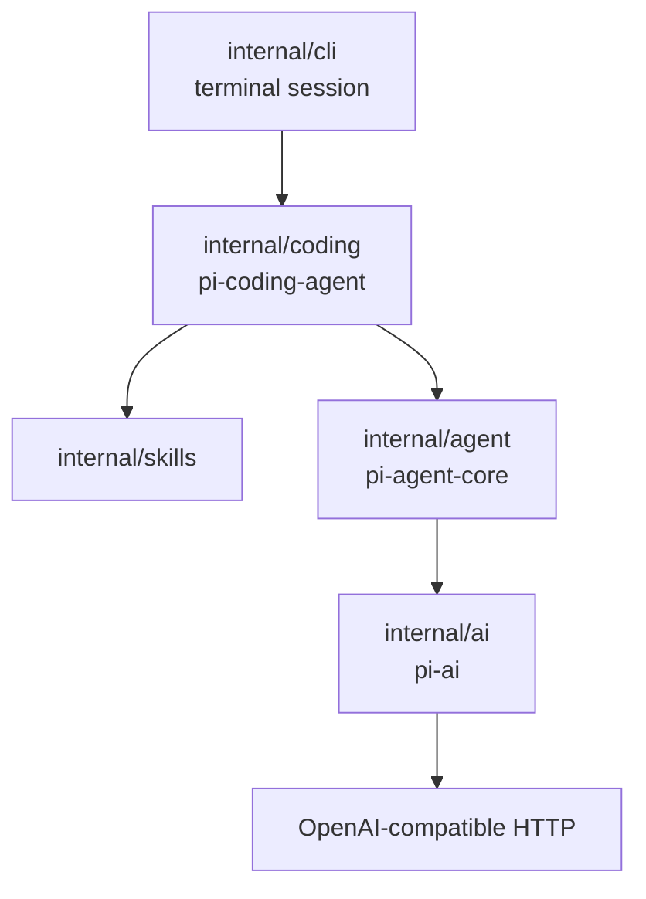
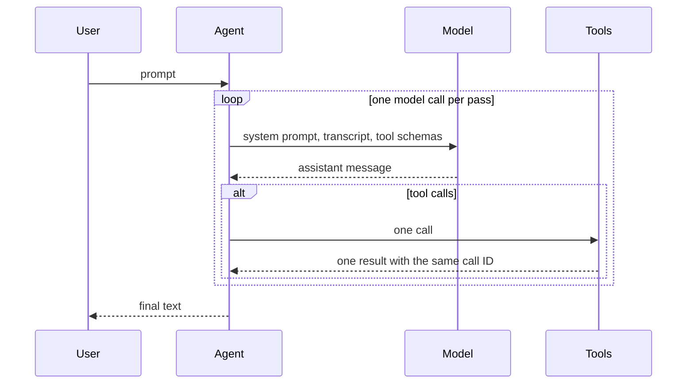
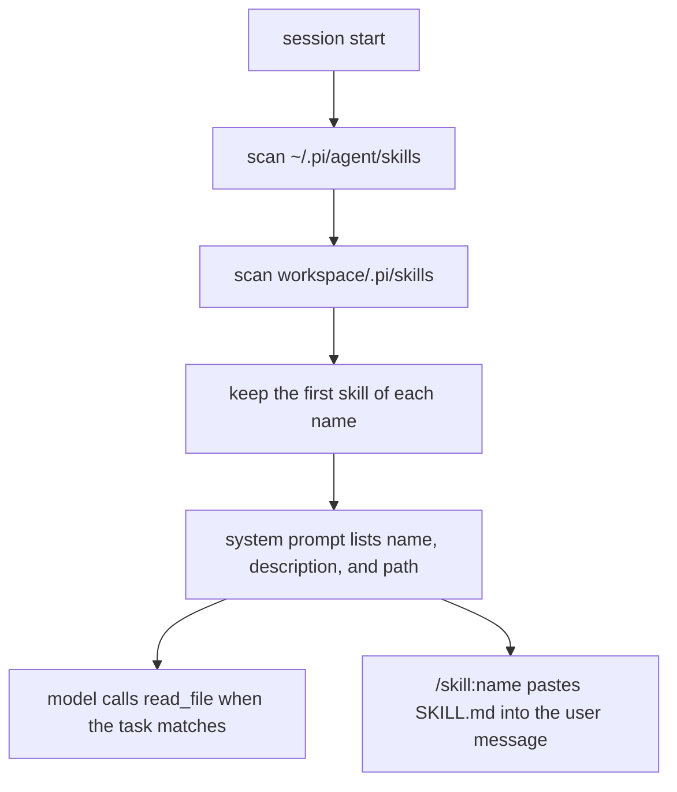

# How pigo follows Pi

[中文](design.zh-CN.md) · [README](../README.md)

pigo is a small Go program for reading [Pi](https://github.com/earendil-works/pi)'s core ideas. It keeps the same three layers and leaves out the marketplace, extensions, and full TUI.

## Three layers

| Layer | May know about | Must not know about |
| --- | --- | --- |
| `internal/ai` | Messages, tool schemas, streaming, HTTP | Running a tool, files, the loop |
| `internal/agent` | Transcript, the ask/act loop, calling `Tool.Execute` | HTTP, workspaces, skills |
| `internal/coding` | Workspace, file and shell tools, the system prompt | How SSE is parsed |
| `internal/skills` | Where `SKILL.md` lives, the short prompt list | The loop and HTTP |
| `internal/config` | Flags, environment, `.env`, YAML config files | The loop, HTTP, and the screen |
| `internal/cli` | Cobra, Bubble Tea, `/skill:name`, calling `config.Load` | Path checks and the wire format |

A skill never becomes a new agent type. The coding session discovers skills and either mentions them in the system prompt or, for `/skill:name`, pastes the file into an ordinary user message. `Agent.Prompt` still only sees messages and tools.

## Transcript and wire format

The transcript is the memory of the loop. A message has a role, text, and for the assistant a list of tool calls. A tool result is its own role, `toolResult`, and carries the tool-call ID it answers.

OpenAI chat completions use a different shape: tool calls are nested under `function`, and a tool result is `role: "tool"`. `encodeRequest` in `internal/ai` is the only place that translation happens. The rest of the program keeps the flatter transcript.

The system prompt is attached when a request is built. It is not stored in the transcript, so `Reset` can drop messages and leave the prompt, model, and tools in place.

## The agent loop

One pass of `run` is one model call. Text deltas are for the screen. The `done` event is the assistant message stored in the transcript.

If that message has tool calls, each call is executed and paired with a `toolResult` that reuses the call ID. The next pass sends both. A call that is canceled or unknown still gets a result. An assistant message with an unpaired tool call would make the next request invalid.

The turn limit is 25 model calls.

## Configuration

`internal/config` is the only package that reads process settings. koanf merges one flat struct. Nothing under `internal/agent`, `internal/ai`, or `internal/coding` imports it.

Precedence, from lowest to highest: defaults, `~/.pigo/config.yaml`, `./pigo.yaml`, `.env`, the environment (`PIGO_PROVIDER`, `OPENAI_API_KEY`, `OPENAI_BASE_URL`, `OPENAI_MODEL`), then flags. Blank values are skipped. The CLI is Cobra: `pigo` opens the chat, and `-p` / `--print` runs one prompt.

The chat screen stays in `internal/cli`. It does not use the alternate screen. The wordmark and finished turns are printed into the terminal scrollback, and the view redraws only the streaming reply, the bordered input, and the footer. `Agent.Prompt` still only receives the text.

## Tools and the workspace

`Workspace.Resolve` makes a path absolute from the workspace root, follows symlinks, and rejects a target outside that root. The check uses the resolved path, so a link inside the project cannot point at a file outside it.

`read_file` has one extra allowance. After the workspace check fails, it may still open a file inside a discovered skill directory. That is how a skill in `~/.pi/agent/skills` can be loaded. `write_file` and `edit_file` do not get that allowance.

`run_command` starts a shell whose working directory is the workspace. The shell is an ordinary process. `OPENAI_API_KEY` is removed from its environment.

## Skills

Discovery follows Pi at a teaching scale:

- User skills are scanned before project skills. The first name wins, so a user skill overrides a project skill.
- A directory that contains `SKILL.md` is a skill root. Children are not scanned.
- Other directories are scanned recursively. Names that start with `.` and `node_modules` are skipped.
- A directory symlink that points outside the skills root is not walked. When that directory contains `SKILL.md`, it is still one skill. The walk remembers resolved paths, so a symlink cycle stops. A `SKILL.md` that points at a file outside its own directory is skipped.
- A markdown file placed directly in the skills root is also a skill when it has frontmatter.
- Frontmatter is a `key: value` block between `---` lines. A missing description drops the file. A description longer than 1024 characters is shortened to that length. A missing name falls back to the directory name. Names are lowercase letters, digits, and single hyphens, at most 64 characters.
- `disable-model-invocation: true` omits the skill from the prompt. `/skill:name` can still run it.

The prompt section tells the model to call `read_file` on the skill path. The file body is not copied into the prompt. Relative paths mentioned by the skill are resolved against the skill directory, and that absolute path is what the tool should receive.

`/skill:name optional request` is handled in the CLI before `Prompt`. It reads `SKILL.md` and sends one user message that already contains the file plus the request. The loop does not grow a skill command.

Pi also honors ignore files, ancestor `.agents/skills` directories, and package skills. pigo skips those so the walk stays short enough to read in one sitting.

## What is left out

A full Pi TUI, native APIs for every vendor, the skills marketplace, session files, sub-agents, and telemetry. The point of the tree is the layering: transport, loop, and coding product.
