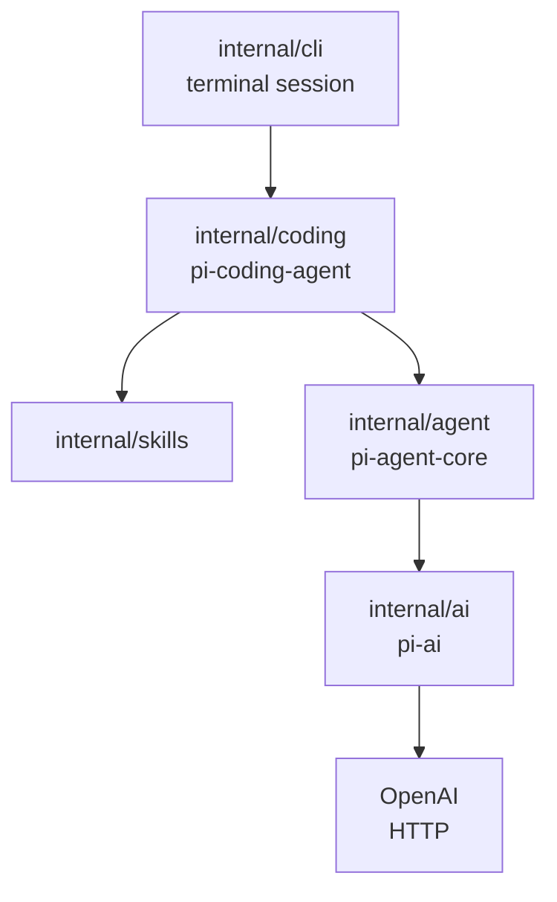
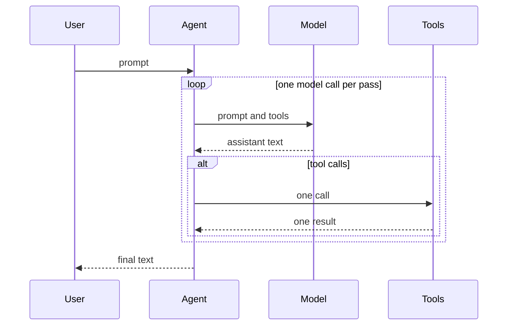
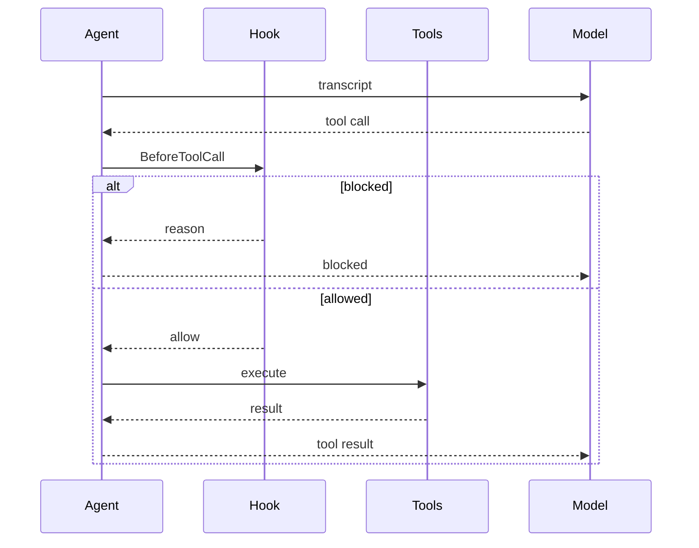
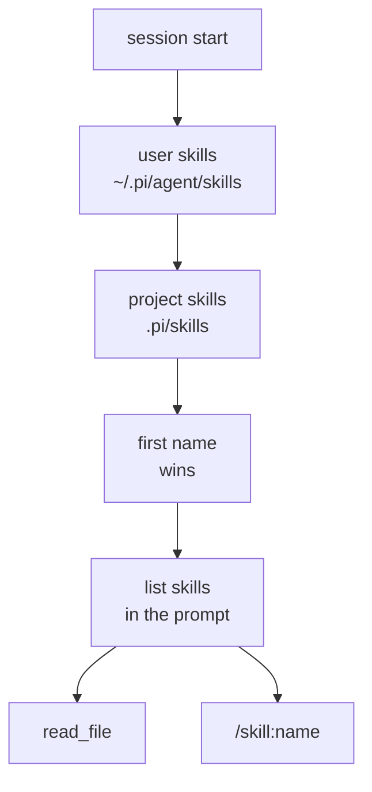

# How pigo follows Pi

[中文](design.zh-CN.md) · [TUI](tui.md) · [README](../README.md)

pigo is a small Go program for reading [Pi](https://github.com/earendil-works/pi)'s core ideas. It keeps the same three layers and leaves out the marketplace, extensions, and full TUI.

## Three layers



| Layer | May know about | Must not know about |
| --- | --- | --- |
| `internal/ai` | Messages, tool schemas, streaming, HTTP | Running a tool, files, the loop |
| `internal/agent` | Transcript, the ask/act loop, calling `Tool.Execute` | HTTP, workspaces, skills |
| `internal/coding` | Workspace, file and shell tools, the system prompt | How SSE is parsed |
| `internal/skills` | Where `SKILL.md` lives, the short prompt list | The loop and HTTP |
| `internal/config` | Flags, environment, `.env`, YAML config files | The loop, HTTP, and the screen |
| `internal/cli` | Cobra, Bubble Tea, `/skill:name`, calling `config.Load` | Path checks and the wire format |

A skill never becomes a new agent type. The coding session discovers skills and either mentions them in the system prompt or, for `/skill:name`, pastes the file into an ordinary user message. `Agent.Prompt` still only sees messages and tools.

## Transcript and wire format

The transcript is the memory of the loop. A message has a role, text, and for the assistant a list of tool calls. A tool result is its own role, `toolResult`, and carries the tool-call ID it answers.

OpenAI chat completions use a different shape: tool calls are nested under `function`, and a tool result is `role: "tool"`. `encodeRequest` in `internal/ai` is the only place that translation happens. The rest of the program keeps the flatter transcript.

The system prompt is attached when a request is built. It is not stored in the transcript, so `Reset` can drop messages and leave the prompt, model, and tools in place.

## The agent loop



One pass of `run` is one model call. Text deltas are for the screen. The `done` event is the assistant message stored in the transcript.

If that message has tool calls, each call is executed and paired with a `toolResult` that reuses the call ID. The next pass sends both. A call that is canceled or unknown still gets a result. An assistant message with an unpaired tool call would make the next request invalid.

The turn limit is 25 model calls.

## Dangerous commands

The agent core does not decide which commands are safe. `BeforeToolCall` runs after the model asks for a tool and before `Execute`. The hook can allow the call, block it, or replace its arguments. A blocked call still gets a tool result, so the turn continues and the model can adapt.



`internal/coding` is the only place that names dangerous shell commands. It matches `run_command` against a short denylist:

- `rm -rf` of `/`, `~`, or `$HOME`
- `sudo`
- `mkfs`
- `dd` writing to a disk device (`of=/dev/sd*`, and `nvme`, `hd`, `mmcblk`, `xvd`, `vd`)
- `git push --force`, including `-f`
- `curl` or `wget` piped into a shell
- a fork bomb
- `chmod -R 777 /`
- a redirect onto those disk devices

`rm -rf ./build` and `git push --force-with-lease` are not on the list.

In the interactive chat, a match replaces the working row with a confirm prompt:

```text
! allow this command?
rm -rf /
recursive delete of / or home
enter allow · esc deny
```

Enter or `y` runs the command. Esc or `n` denies it. The tool result is `blocked:` plus the reason, and the turn goes on. Ctrl-C still aborts the turn. One-shot mode (`-p`) and the line REPL have no prompt, so they deny. `--yolo`, `yolo: true` in a config file, or `PIGO_YOLO=1` skips the check.

This is a pattern denylist. It is easy to bypass with a script, encoding, an alias, or a wrapper such as `env rm`. It guards against a model slip, not an adversary. Real isolation needs a sandbox: a container, macOS seatbelt, or Linux landlock.

## Tests

`go test ./...` runs the unit tests and the hermetic end-to-end tests in `e2e`. Those tests open an `httptest` server that streams OpenAI-compatible events, including tool calls, and drive `coding.Session`, `pigo -p`, and the Bubble Tea model. `go test -tags e2e ./e2e/live` (`make e2e`) runs the same kind of task against a real model and skips when `OPENAI_API_KEY` or `OPENAI_BASE_URL` is unset. CI runs the hermetic suite on every push and pull request. The live job runs on `main`, on manual dispatch, and on pull requests from this repository, and it skips when the repository secrets are missing.

## Configuration

`internal/config` is the only package that reads process settings. koanf merges one flat struct. Nothing under `internal/agent`, `internal/ai`, or `internal/coding` imports it.

Precedence, from lowest to highest: defaults, `~/.pigo/config.yaml`, `./pigo.yaml`, `.env`, the environment (`PIGO_PROVIDER`, `OPENAI_API_KEY`, `OPENAI_BASE_URL`, `OPENAI_MODEL`, `PIGO_YOLO`), then flags. Blank values are skipped. The built-in model is `gpt-5.6-luna`. The CLI is Cobra: `pigo` opens the chat, `-p` / `--print` runs one prompt, and `--yolo` skips the dangerous-command check.

A chat request sends `model`, `messages`, `tools`, and `stream`. It does not send `max_tokens`, `temperature`, or `top_p`. GPT-5 reasoning models reject those fields, and leaving them off keeps other OpenAI-compatible providers on their own defaults.

The chat screen stays in `internal/cli`. It uses the alternate screen, as Codex does. On quit (`/exit`, Ctrl-C while idle, or Ctrl-D with an empty composer) Bubble Tea leaves that screen and the terminal shows the shell buffer from before pigo. Nothing is written after quit. The line session and `-p` do not change the screen, and a non-terminal stdout never enters the alternate screen. Bubble Tea v2 places the hardware cursor on the composer and asks the terminal for keyboard disambiguation so Shift+Enter can insert a newline.

The wordmark, a bordered session card, and the turns are drawn in the transcript pane, with one blank line between cells. The composer, the slash menu, the working row, and the footer stay fixed under that pane. PgUp and PgDn scroll by the pane height minus one line. The mouse wheel scrolls one line. Esc jumps back to the latest line when the composer is idle and no slash menu is open. While the view is following, new output sticks to the bottom. A blank line sits above the footer, and the working row has one blank line above it and one below it. Enter commits the user line to the transcript and clears the composer. While the turn runs, the working row above the input shows a spinner, the elapsed time, and `esc to interrupt`. Esc during a turn interrupts it instead of jumping. A dangerous shell command replaces that row with a confirm prompt until Enter or Esc. Startup leaves one blank line before the wordmark. Shift+Enter inserts a newline when the terminal can report it; Ctrl+J, Alt+Enter, and a trailing backslash do that on terminals that cannot. Assistant prose is pale yellow `#E8D9A8`. Inline code, headings, and links are cyan, diff lines are green and red, the `Ran` header is bold, and tool previews are dim. Text wraps to the terminal width, and a resize wraps the transcript again from its source. `Agent.Prompt` still only receives the text.

## Tools and the workspace

`Workspace.Resolve` makes a path absolute from the workspace root, follows symlinks, and rejects a target outside that root. The check uses the resolved path, so a link inside the project cannot point at a file outside it.

`read_file` has one extra allowance. After the workspace check fails, it may still open a file inside a discovered skill directory. That is how a skill in `~/.pi/agent/skills` can be loaded. `write_file` and `edit_file` do not get that allowance.

`run_command` starts a shell whose working directory is the workspace. The shell is an ordinary process. `OPENAI_API_KEY` is removed from its environment. The denylist in [Dangerous commands](#dangerous-commands) can block the command before that process starts.

## Skills



Discovery follows Pi at a teaching scale:

- User skills are scanned before project skills. The first name wins, so a user skill overrides a project skill.
- A directory that contains `SKILL.md` is a skill root. Children are not scanned.
- Other directories are scanned recursively. Names that start with `.` and `node_modules` are skipped.
- A directory symlink that points outside the skills root is not walked. When that directory contains `SKILL.md`, it is still one skill. The walk remembers resolved paths, so a symlink cycle stops. A `SKILL.md` that points at a file outside its own directory is skipped.
- A markdown file placed directly in the skills root is also a skill when it has frontmatter.
- Frontmatter is a `key: value` block between `---` lines. A missing description drops the file. A description longer than 1024 characters is shortened to that length. A missing name falls back to the directory name. Names are lowercase letters, digits, and single hyphens, at most 64 characters.
- `disable-model-invocation: true` omits the skill from the prompt. `/skill:name` can still run it.

The prompt section tells the model to call `read_file` on the skill path. The file body is not copied into the prompt. Relative paths mentioned by the skill are resolved against the skill directory, and that absolute path is what the tool should receive.

`/skill:name optional request` is handled in the CLI before `Prompt`. It reads `SKILL.md` and sends one user message that already contains the file plus the request. The loop does not grow a skill command.

Pi also honors ignore files, ancestor `.agents/skills` directories, and package skills. pigo skips those so the walk stays short enough to read in one sitting.

## What is left out

A full Pi TUI, native APIs for every vendor, the skills marketplace, session files, sub-agents, and telemetry. The point of the tree is the layering: transport, loop, and coding product.
