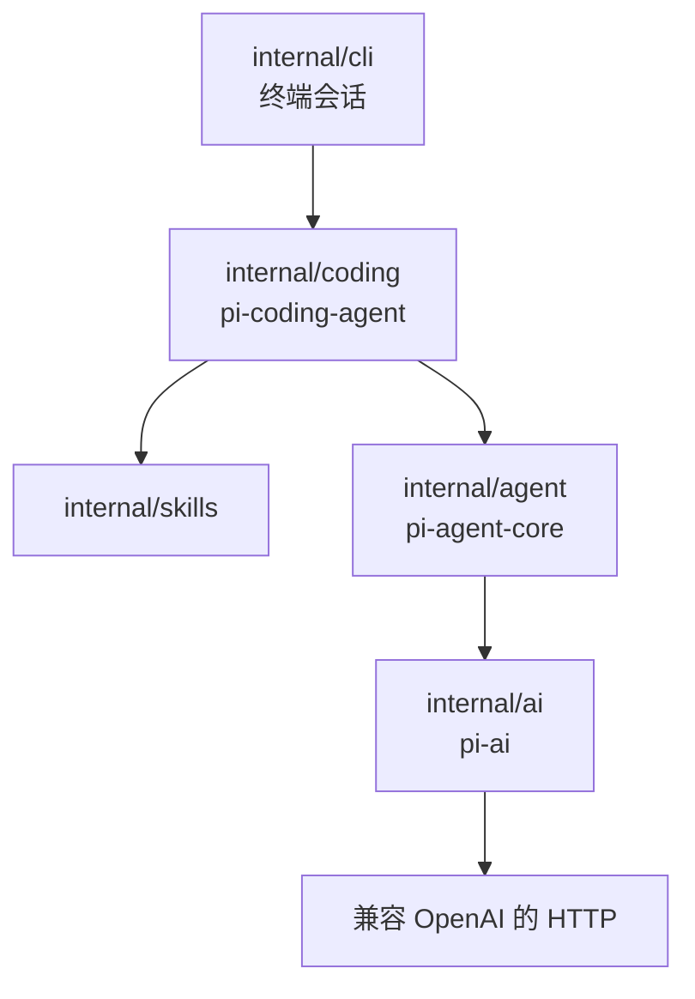
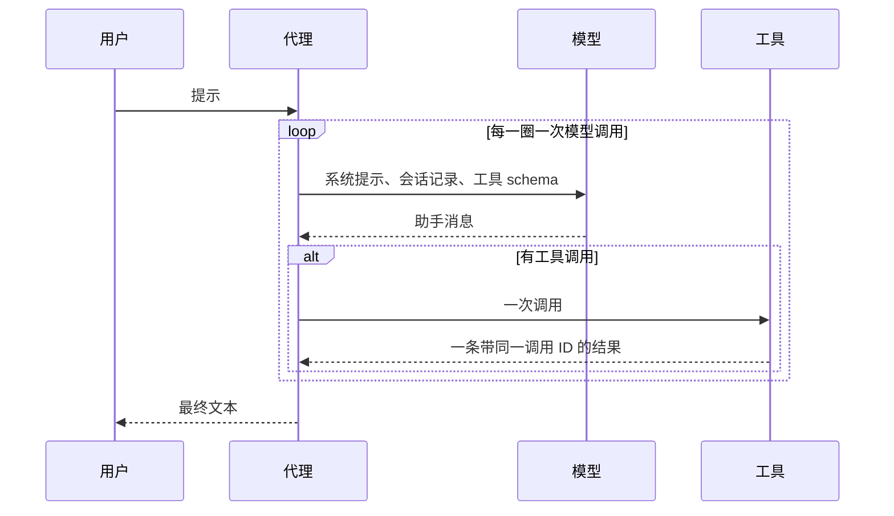
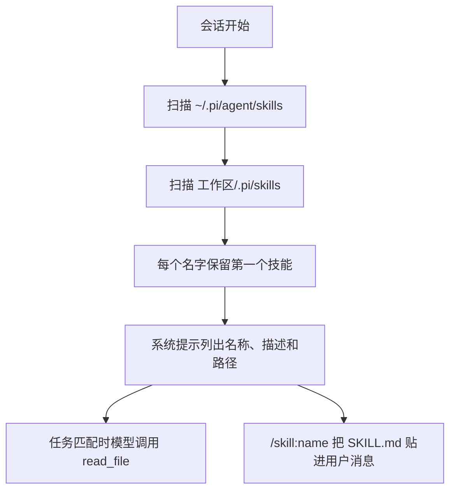

# pigo 如何对应 Pi

[English](design.md) · [说明](../README.zh-CN.md)

pigo 是一个用来阅读 [Pi](https://github.com/earendil-works/pi) 核心想法的小型 Go 程序。它保留同样的三层，不包含技能市场、扩展和完整 TUI。

## 三层

| 层 | 可以知道 | 不应知道 |
| --- | --- | --- |
| `internal/ai` | 消息、工具 schema、流式输出、HTTP | 执行工具、文件、循环 |
| `internal/agent` | 会话记录、询问再行动的循环、调用 `Tool.Execute` | HTTP、工作区、技能 |
| `internal/coding` | 工作区、文件和 shell 工具、系统提示 | SSE 如何解析 |
| `internal/skills` | `SKILL.md` 在哪里、提示词里的简短列表 | 循环和 HTTP |
| `internal/cli` | 标志、环境变量、Bubble Tea、`/skill:name` | 路径检查和线路格式 |

技能不会变成一种新的代理。编码会话发现技能后，要么把它们写进系统提示，要么在 `/skill:name` 时把文件贴进一条普通用户消息。`Agent.Prompt` 看到的仍然只是消息和工具。

## 会话记录和线路格式

会话记录是循环的记忆。一条消息有角色和文本；助手消息还可以带一组工具调用。工具结果是单独的角色 `toolResult`，并带上它回答的那次调用的 ID。

OpenAI chat completions 的形状不同：工具调用嵌在 `function` 里，工具结果的角色是 `tool`。`internal/ai` 的 `encodeRequest` 是唯一做这个转换的地方。程序其余部分保持更平坦的会话记录。

系统提示在构造请求时附上。它不写入会话记录，所以 `Reset` 可以丢掉消息，同时留下提示、模型和工具。

## 代理循环

`run` 的一圈就是一次模型调用。文本增量给界面看。`done` 事件才是写入会话记录的助手消息。

如果这条消息带有工具调用，每次调用都会执行，并配上一条复用该调用 ID 的 `toolResult`。下一圈会把两者一起发出去。被取消或未知的调用也会得到一条结果。助手消息里若有未配对的工具调用，下一次请求就会无效。

轮数上限是 25 次模型调用。

## 工具和工作区

`Workspace.Resolve` 把路径从工作区根目录变成绝对路径，跟随符号链接，并拒绝根目录之外的目标。检查用的是解析之后的路径，所以项目内部的链接不能指向外面的文件。

`read_file` 多一条许可。工作区检查失败后，它仍可以打开已发现技能目录中的文件。`~/.pi/agent/skills` 里的技能就是这样被读到的。`write_file` 和 `edit_file` 没有这条许可。

`run_command` 启动的 shell 以工作区为当前目录。它是普通进程。环境里的 `OPENAI_API_KEY` 会被去掉。

## 技能

发现规则按教学所需的规模跟随 Pi：

- 先扫描用户技能，再扫描项目技能。同名时保留第一个，所以用户技能覆盖项目技能。
- 含有 `SKILL.md` 的目录是技能根，不再扫描子目录。
- 其他目录会递归扫描。以 `.` 开头的名字和 `node_modules` 会被跳过。
- 直接放在技能根目录、并且带有前置信息的 markdown 文件也算一个技能。
- 前置信息是夹在 `---` 之间的 `key: value`。描述为空则丢弃该文件；名字为空则用目录名。名字由小写字母、数字和单个连字符组成，最长 64 个字符。
- `disable-model-invocation: true` 会把技能从提示词中去掉。`/skill:name` 仍然可以运行它。

提示词要求模型对技能路径调用 `read_file`。文件正文不会复制进提示词。技能里提到的相对路径要相对技能目录解析，工具收到的应是那个绝对路径。

`/skill:name` 以及可选的请求由 CLI 在 `Prompt` 之前处理。它读出 `SKILL.md`，发出一条已经包含文件和请求的用户消息。循环本身不增加技能命令。

Pi 还会遵守忽略文件、上层目录的 `.agents/skills`，以及包里的技能。pigo 不做这些，这样整段扫描可以一次读完。

## 留出的部分

完整的 Pi TUI、各家厂商的原生 API、技能市场、会话文件、子代理，以及遥测。这棵目录要说明的是分层：传输、循环、编码产品。
