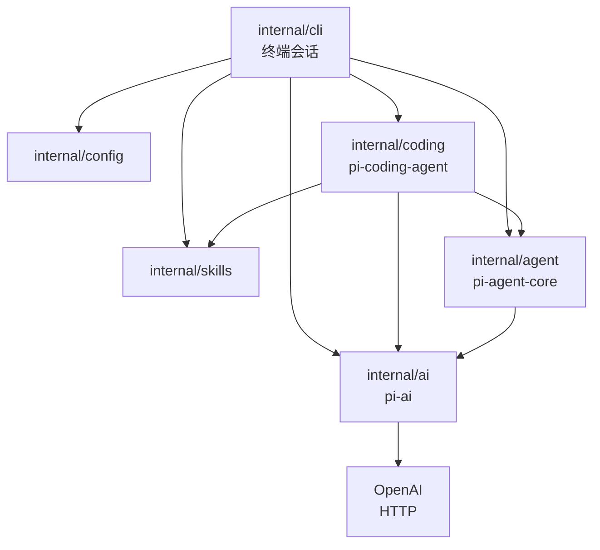
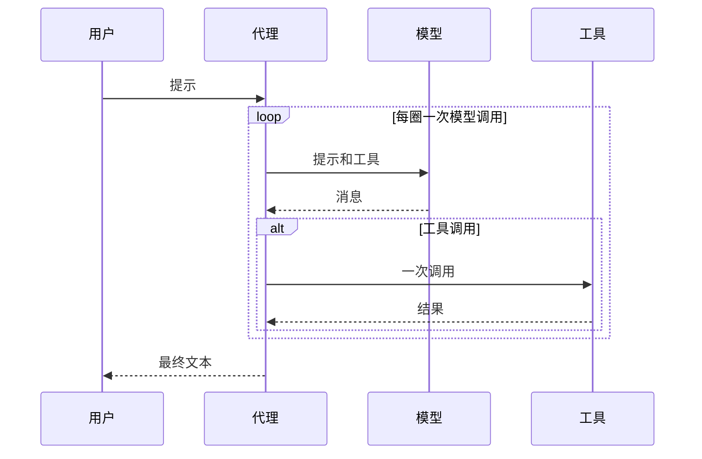
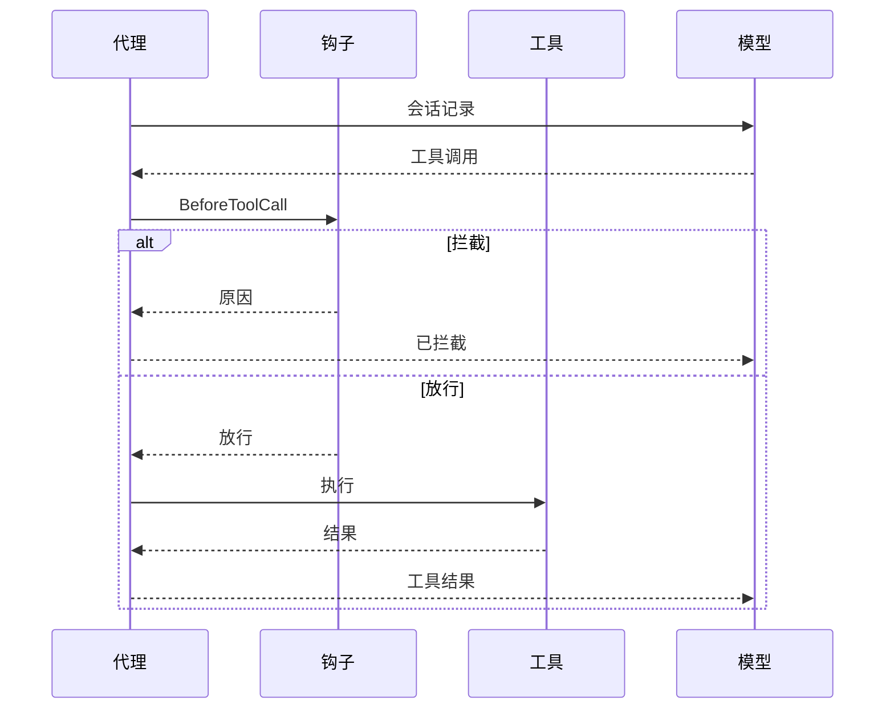
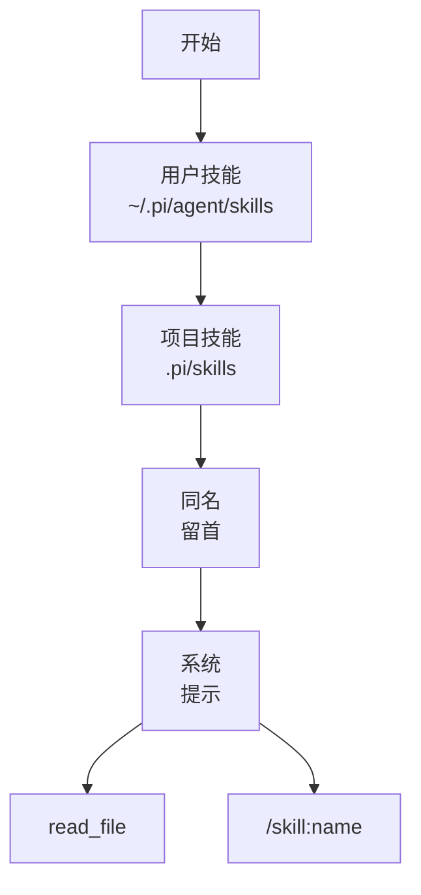

# pigo 如何对应 Pi

[English](design.md) · [界面](tui.zh-CN.md) · [说明](../README.zh-CN.md)

pigo 是一个用来阅读 [Pi](https://github.com/earendil-works/pi) 核心想法的小型 Go 程序。它保留同样的三层，不包含技能市场、扩展和完整 TUI。

## 三层



| 层 | 可以知道 | 不应知道 |
| --- | --- | --- |
| `internal/ai` | 消息、工具 schema、流式输出、HTTP | 执行工具、文件、循环 |
| `internal/agent` | 会话记录、询问再行动的循环、调用 `Tool.Execute` | HTTP、工作区、技能 |
| `internal/coding` | 工作区、文件和 shell 工具、系统提示 | SSE 如何解析 |
| `internal/skills` | `SKILL.md` 在哪里、提示词里的简短列表 | 循环和 HTTP |
| `internal/config` | 命令行参数、环境变量、`.env`、YAML | 循环、HTTP 和画面 |
| `internal/cli` | Cobra、Bubble Tea、`/skill:name`、调用 `config.Load` | 路径检查和线路格式 |

技能不会变成一种新的代理。编码会话发现技能后，要么把它们写进系统提示，要么在 `/skill:name` 时把文件贴进一条普通用户消息。`Agent.Prompt` 看到的仍然只是消息和工具。

## 会话记录和线路格式

会话记录是循环的记忆。一条消息有角色和文本；助手消息还可以带一组工具调用。工具结果是单独的角色 `toolResult`，并带上它回答的那次调用的 ID。

OpenAI chat completions 的形状不同：工具调用嵌在 `function` 里，工具结果的角色是 `tool`。`wire.go` 为每一层 JSON 对象起一个具名类型。`encodeRequest` 写出请求，累加器读入每个 `wireChunk`，两边都用 `json.Marshal` 和 `json.Unmarshal`。程序其余部分保持更平坦的会话记录。

系统提示在构造请求时附上。它不写入会话记录，所以 `Reset` 可以丢掉消息，同时留下提示、模型和工具。磁盘上的会话文件也遵守这条规则，见 [会话文件](#会话文件)：文件里是对话，下一次请求再重建提示。

流式请求会带上 `stream_options.include_usage`。某个 chunk 带有 `usage` 时，累加器保留最后一次：`prompt_tokens` 或 `input_tokens`，`completion_tokens` 或 `output_tokens`，以及提供方给出的 `total_tokens`。同一次调用里的用量不会相加。每次报告的调用累加进内存里的会话合计，`Reset` 连同会话记录一起丢掉这个合计。状态栏用 Codex 的写法显示合计（`1.2K in · 340 out`）；提供方没有给用量时不显示。`-p` 和逐行会话在某次调用带了用量时打一行。这些计数不写入会话文件，也没有价目表。

## 代理循环



`run` 的一圈就是一次模型调用。文本增量给界面看。`done` 事件才是写入会话记录的助手消息。

如果这条消息带有工具调用，每次调用都会执行，并配上一条复用该调用 ID 的 `toolResult`。下一圈会把两者一起发出去。被取消或未知的调用也会得到一条结果。助手消息里若有未配对的工具调用，下一次请求就会无效。

轮数上限是 25 次模型调用。

## 会话文件

pigo 把会话记录追加进 JSONL 文件。形状跟随 [Pi 的会话格式](https://pi.dev/docs/latest/session-format)：一行一个 JSON 对象，第一行是文件头，后面的条目用 `id` 和 `parentId` 连起来。pigo 只往当前叶子后面追加，所以它写出的文件是一条链。读取时仍然从最后一行走回根。模型看到的就是这条路径。文件里的旁支留在磁盘上，不会送出。没有树形界面。


文件在 `~/.pigo/sessions/` 下，每个工作区一个目录：

```text
~/.pigo/sessions/--tmp-project--/2026-10-19T17-40-00-000Z_<uuid>.jsonl
```

目录名是工作区路径：去掉开头的一个分隔符，把 `/`、`\` 和 `:` 换成 `-`，再前后加上 `--`。这是 Pi 的编码。根目录是 `~/.pigo/sessions`，不是 `~/.pi/agent/sessions`。pigo 只写 Pi 条目里的一部分，放进 Pi 的目录会被 Pi 打开。`PIGO_SESSION_DIR`、配置文件里的 `session_dir`，或 `--session-dir`，可以改这个根。目录按 `0700` 创建，每个文件按 `0600` 创建，因为记录里可能有源码和命令输出。

文件在第一条用户消息时创建。没有提示就退出，不会留下文件。之后每条消息追加一行，并在这一轮继续之前同步到磁盘。崩溃可能写坏最后一行。读取时丢掉末尾不完整的一行，保留已经写完的行。中间有坏行则报错，避免把截断的文件当成完整会话。

```json
{"type":"session","version":3,"id":"550e8400-e29b-41d4-a716-446655440000","timestamp":"2026-10-19T17:40:00.000Z","cwd":"/tmp/project"}
{"type":"message","id":"a1b2c3d4","parentId":null,"timestamp":"2026-10-19T17:40:01.000Z","message":{"role":"user","content":"hello","timestamp":1760895601000}}
{"type":"message","id":"b2c3d4e5","parentId":"a1b2c3d4","timestamp":"2026-10-19T17:40:02.000Z","message":{"role":"assistant","content":[{"type":"text","text":"hi"}],"model":"gpt-5.6-luna","stopReason":"stop","timestamp":1760895602000}}
```

版本 3 是 Pi 当前的文件头。助手的文本和工具调用使用 Pi 的内容块（`text`、`toolCall`）。工具结果的角色是 `toolResult`。内存里的消息仍然是平坦的。这一层转换只出现在文件边上。系统提示不写入文件。文件里如果有 `system` 消息，读取时会跳过，请求构造时再附上当前的提示。`message` 以外的条目也会跳过，包括 `usage`、`label` 和 `compaction`。压缩不会被应用，所以带有摘要的文件仍然会把叶子路径上的消息送出去。没有 `parentId` 的版本 1 文件按行序读取。

没有对应结果的工具调用会在读取时丢掉，没有对应调用的工具结果也一样。文件不会被改写。工具对被写坏时，下一次请求仍然合法。

| 参数 | 作用 |
| --- | --- |
| `-c`、`--continue` | 打开这个工作区最新的文件。没有文件就新开一个会话。 |
| `--session <path\|id>` | 打开一个 JSONL 路径、完整 id，或这个工作区目录里唯一的 id 前缀。 |
| `--no-session` | 会话记录只留在内存里。不读也不写。 |
| `--session-dir` | 会话根目录。覆盖 `PIGO_SESSION_DIR` 和 `session_dir`。 |

`-c`、`--session` 和 `--no-session` 不能一起用。聊天和 `-p` 都可以恢复。文件里已经有消息时，`-p` 和逐行会话会打印 `resumed <id> (N messages)`。聊天在第一次提示之前把这些消息画进对话区。发给模型的是当前系统提示、叶子路径，然后是新的用户消息。恢复时用的是你这次启动的模型。助手行里记下的是写出那条消息的模型。

`/reset` 清掉当前的会话记录和内存里的 token 合计，画面上打一条分隔。分隔线上面的文字还在。原来的文件也还在。已经有文件时，逐行会话会打印 `previous session <id>`。下一条提示才会新建文件。reset 之后如果没有新的提示，`--continue` 仍会打开原来的文件，因为新文件还不存在。token 计数不在文件里。恢复或 reset 之后，要等提供方再次报告用量，合计才重新开始。

删掉一个会话，就是删掉它的 `.jsonl` 文件。

会话选择器、显示名、分支、分叉、压缩和上下文编辑都不在这一版里。叶子遍历留在这里，是因为带有旁支的文件仍然必须载入下一次请求要发送的那条路径。

| 题目 | 选择 | 另一条路 | 原因 |
| --- | --- | --- | --- |
| 目录 | `~/.pigo/sessions`，路径编码跟 Pi | `~/.pi/agent/sessions` | 布局认得出来。文件只是子集，所以不放进 Pi 的目录 |
| 形状 | 文件头加上带 `id` / `parentId` 的消息 | 一套私有的记录转储 | 读取可以沿叶子走。写入只追加，代码就短 |
| 提示 | 每次请求重新构造 | 存下 Pi 的系统消息 | 代理本来就不把提示放进会话记录。两次运行之间技能可能变了 |
| 用量 | 留在内存 | 写入 Pi 的 usage 条目 | 用量已经显示在这一次进程里。恢复后合计从头算 |
| `/reset` | 新文件，旧文件保留 | 截断当前文件 | 只追加才和这个格式一致。旧对话可以用 `--session` 打开 |

## 危险命令

代理核心不判断命令安不安全。模型要调用工具之后、`Execute` 之前，会先走 `BeforeToolCall`。钩子可以放行、拦截，或换掉参数。被拦截的调用仍然得到一条工具结果，这一轮继续，模型可以改做法。



只有 `internal/coding` 列出危险的 shell 命令。它用一张短拒绝表匹配 `run_command`。选项可以写在路径后面（如 `rm ~ -rf`）；`--` 之后的词一律当操作数：

- 对 `/`、`~` 或 `$HOME` 执行 `rm -rf`
- `sudo`
- `mkfs`
- `dd` 写到磁盘设备（`of=/dev/sd*`，以及 `nvme`、`hd`、`mmcblk`、`xvd`、`vd`）
- `git push --force`，包括 `-f`
- `curl` 或 `wget` 通过管道送进 shell
- fork bomb
- `chmod -R 777 /`
- 重定向到这些磁盘设备

`rm -rf ./build` 和 `git push --force-with-lease` 不在表里。

交互聊天里，命中后工作行换成确认提示：

```text
! allow this command?
rm -rf /
recursive delete of / or home
enter allow · esc deny
```

Enter 或 `y` 执行。Esc 或 `n` 拒绝。工具结果是 `blocked:` 加上原因，这一轮继续。Ctrl-C 仍然中止这一轮。单次模式（`-p`）和行会话没有提示，所以直接拒绝。这两种模式在 Ctrl+C 时取消这一轮，而不是让信号直接杀掉进程。`--yolo`、配置文件里的 `yolo: true`，或 `PIGO_YOLO=1`，会跳过检查。聊天画面和行会话共用一张命令表：`/exit`、`exit`、`quit`、`/quit` 和 `/reset`。

这是一张模式拒绝表。脚本、编码、别名、`git -C`、`(rm -rf /)` 或 `$(…)` 这样的子 shell，或 `env rm` 这样的包装，都很容易绕过。它防的是模型失手，不是对手。真正的隔离需要沙箱：容器、macOS seatbelt，或 Linux landlock。

## 测试

`go test ./...` 跑单元测试和 `e2e` 里的本地端到端测试。这些测试启动一个 `httptest` 服务，按 OpenAI 兼容格式流出事件（含工具调用），并驱动 `coding.Session`、`pigo -p` 和 Bubble Tea 模型。`go test -tags e2e ./e2e/live`（`make e2e`）对真实模型做同类任务；没有 `OPENAI_API_KEY` 或 `OPENAI_BASE_URL` 时跳过。CI 在每次 push 和 pull request 上跑本地套件。真实模型任务在 `main`、手动触发，以及本仓库自己的 pull request 上跑；仓库密钥缺失时跳过。

## 配置

只有 `internal/config` 读取进程设置。koanf 把它们合并成一个扁平结构。`internal/agent`、`internal/ai`、`internal/coding` 都不引用它。`.env` 和技能前言各自去掉一对引号。`.env` 只填补进程里还没有的变量，给 shell 工具用，不会覆盖已经设置的变量。进程环境在 `.env` 之后再写入，所以进程里的值仍然胜过 `.env`。

从低到高的优先级：默认值、`~/.pigo/config.yaml`、`./pigo.yaml`、`.env`、环境变量（`PIGO_PROVIDER`、`OPENAI_API_KEY`、`OPENAI_BASE_URL`、`OPENAI_MODEL`、`PIGO_YOLO`、`PIGO_SESSION_DIR`），然后是命令行参数。空值会被跳过。内置模型是 `gpt-5.6-luna`。命令行用 Cobra：`pigo` 打开聊天，`-p` / `--print` 只跑一条提示，`--yolo` 跳过危险命令检查，`-c` / `--session` 恢复一个会话文件。`--no-session` 让这一次只留在内存里。

一次聊天请求只发送 `model`、`messages`、`tools` 和 `stream`。它不发送 `max_tokens`、`temperature` 或 `top_p`。GPT-5 推理模型会拒绝这些字段；不发送它们，其他兼容 OpenAI 的提供者也继续用自己的默认值。

聊天画面见 [tui.zh-CN.md](tui.zh-CN.md)。

## 工具和工作区

`Workspace.Resolve` 把路径从工作区根目录变成绝对路径，跟随符号链接，并拒绝根目录之外的目标。检查用的是解析之后的路径，所以项目内部的链接不能指向外面的文件。

`read_file` 多一条许可。工作区检查失败后，它仍可以打开已发现技能目录中的文件。`~/.pi/agent/skills` 里的技能就是这样被读到的。`write_file` 和 `edit_file` 没有这条许可。

`run_command` 以工作区为当前目录启动 `bash`。Unix 上需要安装 bash。Windows 上用 `cmd /C`。它是普通进程。过长的输出保留末尾。环境里的 `OPENAI_API_KEY` 会被去掉。[危险命令](#危险命令) 里的拒绝表可以在进程启动前拦住这条命令。

## 技能



发现规则按教学所需的规模跟随 Pi：

- 先扫描用户技能，再扫描项目技能。同名时保留第一个，所以用户技能覆盖项目技能。
- 含有 `SKILL.md` 的目录是技能根，不再扫描子目录。
- 其他目录会递归扫描。以 `.` 开头的名字和 `node_modules` 会被跳过。
- 指向技能根之外的目录符号链接不会被继续遍历。如果该目录自身含有 `SKILL.md`，它仍然是一个技能。扫描会记住解析后的路径，所以符号链接环会停下来。指向本目录之外文件的 `SKILL.md` 会被跳过。
- 直接放在技能根目录、并且带有前置信息的 markdown 文件也算一个技能。
- 前置信息是夹在 `---` 之间的 `key: value`。描述为空则丢弃该文件。超过 1024 个字符的描述会被截到这个长度。名字为空则用目录名。名字由小写字母、数字和单个连字符组成，最长 64 个字符。
- `disable-model-invocation: true` 会把技能从提示词中去掉。`/skill:name` 仍然可以运行它。

提示词要求模型对技能路径调用 `read_file`。文件正文不会复制进提示词。技能里提到的相对路径要相对技能目录解析，工具收到的应是那个绝对路径。

`/skill:name` 以及可选的请求由 CLI 在 `Prompt` 之前处理。它读出 `SKILL.md`，发出一条已经包含文件和请求的用户消息。循环本身不增加技能命令。

Pi 还会遵守忽略文件、上层目录的 `.agents/skills`，以及包里的技能。pigo 不做这些，这样整段扫描可以一次读完。

## 留出的部分

完整的 Pi TUI、各家厂商的原生 API、技能市场、会话分支、会话选择器、压缩、子代理，以及遥测。这棵目录要说明的是分层：传输、循环、编码产品。
