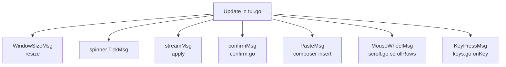
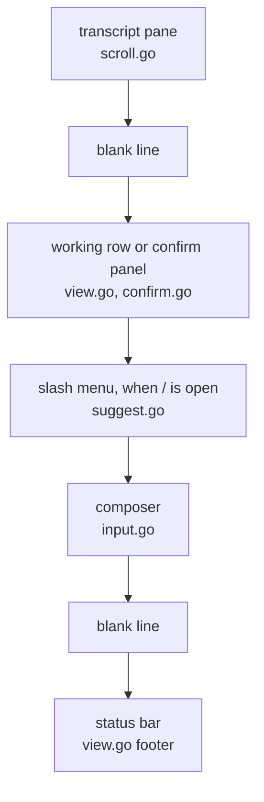
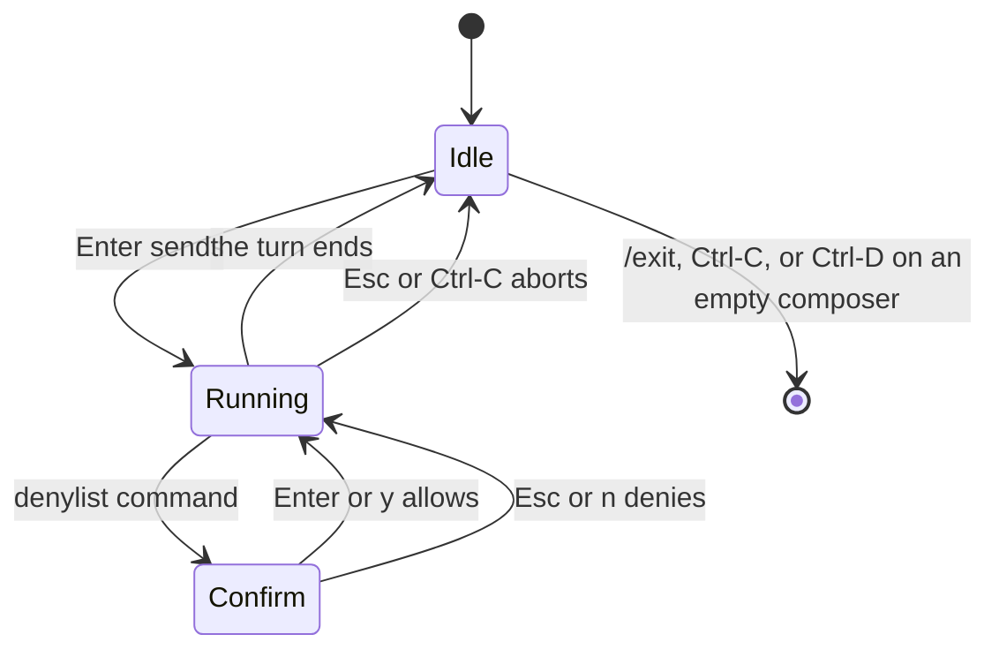

# The chat screen

[中文](tui.zh-CN.md) · [Design](design.md) · [README](../README.md)

The interactive chat is a Bubble Tea v2 program in `internal/cli`. It runs only when both stdin and stdout are terminals. `-p` and a pipe use the line session instead, and never touch the screen.

## Model, update, view

`chatModel` in `tui.go` is the whole session: the composer, the transcript blocks, whether a turn is running, and where the transcript is scrolled. `Update` routes one message. `View` in `view.go` returns a `tea.View`: the frame, the alternate screen, mouse cell motion, and the cursor.

| Concern | File | Where to start |
| --- | --- | --- |
| Model and the turn | `tui.go` | `chatModel`, `runTUI`, `apply`, `submit` |
| Keys | `keys.go` | `onKey`, `onComposer`, `continuedLine` |
| Frame | `view.go` | `View`, `layout`, `chromeAbove`, `footer` |
| Transcript scroll | `scroll.go` | `scrollRows`, `transcriptWindow`, `follow` |
| Composer | `input.go` | `composer`, `inputBlock` |
| Hardware cursor | `cursor.go` | `placeCursor` |
| Width and wrap | `wrap.go` | `wrapText`, `wrapRunes` |
| Wordmark and card | `banner.go` | `opening` |
| Slash menu | `suggest.go` | `menuOpen`, `suggestView` |
| Confirm | `confirm.go` | `confirmView`, `answerConfirm` |
| Colors | `styles.go`, `md.go` | `styleProse` |

## Frame

The transcript fills whatever room is left. The band under it stays put: a blank line, then either the working row or the confirm panel, then the slash menu, then the composer, a blank line, and the status bar.

`layout` measures that band, asks `transcriptWindow` for the visible lines, and returns the caret cell. `placeCursor` puts a steady bar on that cell. The origin is the top left of the frame, so an IME candidate window opens where the user is typing.

Short history stays at the top of the pane. The spare rows sit above the composer.

## A turn

Enter commits the composer, clears it, and calls `Session.Prompt`. Events come back on a channel as `streamMsg`. Text deltas accumulate in `live` and paint as the assistant bubble. A tool start becomes a `• Ran` row; the result is a short dim preview. `AgentEnd` clears `busy` and records the status.

Esc during a turn calls `Abort`. Esc on the confirm panel only denies that command; the turn continues and the tool result is `blocked:`. Ctrl-C denies on the way out and aborts. `--yolo` never sends `confirmMsg`. `-p` and the line session deny instead of asking, because they have no screen to ask on.

## Keys

| Key | When | What |
| --- | --- | --- |
| Enter | idle | send, or complete a partial slash command |
| Shift+Enter, Alt+Enter, Ctrl+J | idle | insert a newline |
| Enter after a trailing `\` | idle | newline, and drop that backslash |
| Esc | running | interrupt |
| Esc | confirm | deny |
| Esc | idle, scrolled, menu closed | jump back to the tail |
| Esc | slash menu | dismiss the menu |
| PgUp, PgDn | any time | one page, one line of overlap |
| wheel | any time | one line |
| Ctrl-C | running | abort; also denies a confirm |
| Ctrl-C | idle | quit |
| Ctrl-D | idle, empty composer | quit |
| Ctrl-U, Ctrl-W | idle | clear the line, or delete a word |
| arrows, Home, End | idle | move the caret; Up and Down move the menu |

Bubble Tea asks the terminal for keyboard disambiguation and turns it off on quit. Terminals that answer deliver Shift+Enter as its own key. The others still have Ctrl+J, Alt+Enter, and the trailing backslash.

## Trade-offs

| Topic | Choice | Alternative | Why |
| --- | --- | --- | --- |
| Screen | Alternate screen, scroll inside the app | Leave the chat in the terminal scrollback | Matches Codex. Quit restores the shell exactly. The cost is that the terminal's own scrollback cannot move through the chat |
| Cursor | `tea.View.Cursor`, a steady bar on the caret cell | Sniff the frame bytes and move the cursor after each paint | v2 already has a cursor field. The hardware cursor is what an IME uses to place its candidate window |
| Newline | Shift+Enter when the terminal can report it | Treat Enter as newline and use another key to send | Enter sends, as in Codex. Ctrl+J, Alt+Enter, and a trailing `\` cover terminals that cannot tell Shift+Enter from Enter |
| Composer | A small `composer` struct and `inputBlock`. bubbles supplies only the spinner | bubbles textarea | The bar is three lines, CJK-aware, and has to report a caret cell. A textarea would be a larger widget for less control |
| Width | `ansi.StringWidth`; spaces wrap first, then hard wrap | Count runes, or let the terminal wrap | CJK is two columns. The caret has to land on a cell, not a byte |
| Resize | Rewrap from the stored source text | Keep the already wrapped lines | The source is the truth. A line offset can drift, which is called out below |
| Look | Codex-like colors, wordmark, segmented status bar | Copy a larger TUI | crush is a useful reference for how a calm chat feels. None of its code is in this tree |
| Other modes | `interactiveTerminal` gates `runTUI` | Always draw the TUI | `-p`, a pipe, and the line session print events and exit. They have no cursor and no confirm prompt |

## Limits

- There is no `--no-alt-screen`. A terminal session is always the alternate screen.
- Quit prints nothing. There is no token total and no resume handle.
- A scroll offset is a wrapped line. Resizing rewraps from the source, so the same offset can land on a different sentence.
- Shift+Enter is a plain Enter on terminals that do not answer the keyboard-disambiguation query.
