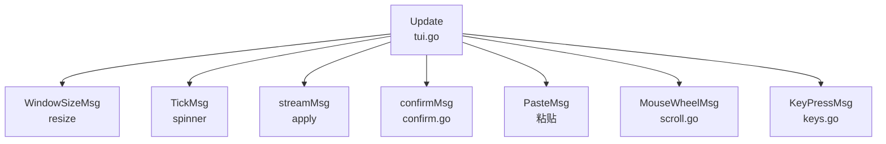
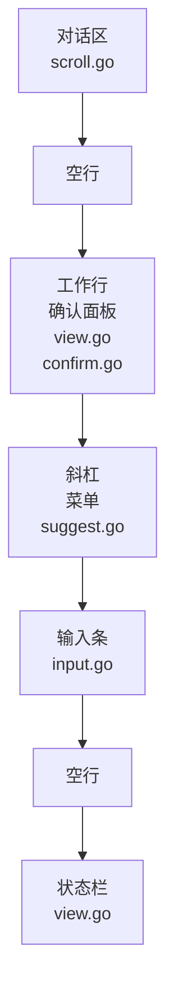
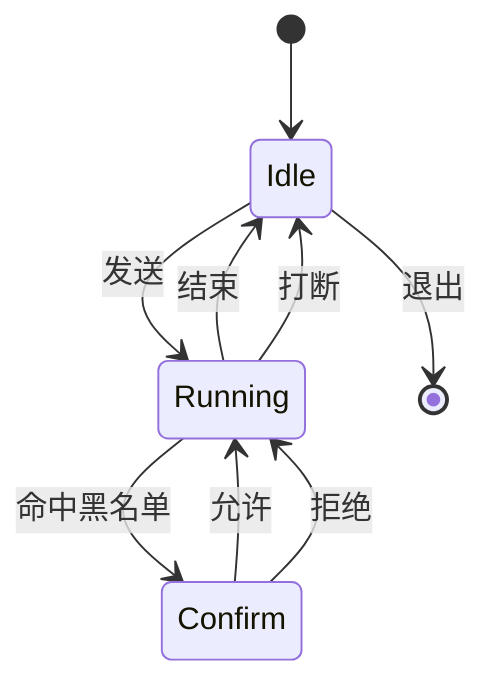

# 聊天界面

[English](tui.md) · [设计说明](design.zh-CN.md) · [说明](../README.zh-CN.md)

交互式聊天是 `internal/cli` 里的一个 Bubble Tea v2 程序。只有标准输入和标准输出都是终端时才会进入。`-p` 和管道走逐行会话，不动屏幕。

## 模型、更新、视图

`tui.go` 里的 `chatModel` 是整个会话：输入条、对话块、这一轮是否在跑，以及对话区滚到了哪里。`Update` 分发一条消息。`view.go` 的 `View` 返回 `tea.View`：画面、备用屏幕、鼠标单元格运动，以及光标。

| 职责 | 文件 | 从这里看 |
| --- | --- | --- |
| 模型和一轮任务 | `tui.go` | `chatModel`、`runTUI`、`apply`、`submit` |
| 按键 | `keys.go` | `onKey`、`onComposer`、`continuedLine` |
| 画面 | `view.go` | `View`、`layout`、`chromeAbove`、`footer` |
| 对话区滚动 | `scroll.go` | `scrollRows`、`transcriptWindow`、`scroll` |
| 输入条 | `input.go` | `composer`、`inputBlock` |
| 硬件光标 | `cursor.go` | `placeCursor` |
| 宽度和折行 | `wrap.go` | `wrapText`、`wrapRunes` |
| 字标和会话卡片 | `banner.go` | `opening` |
| 斜杠菜单 | `suggest.go` | `menuOpen`、`suggestView` |
| 确认 | `confirm.go` | `confirmView`、`answerConfirm` |
| 颜色 | `styles.go`、`md.go` | `styleProse` |

## 画面

对话区占满剩下的高度。它下面的一条是固定的：空一行，然后是工作行或确认面板，然后是斜杠菜单、输入条、再空一行，最后是状态栏。

`layout` 量出这条固定带，向 `transcriptWindow` 要可见的行，并返回插入点所在的单元格。`placeCursor` 在那个单元格放一根稳定的竖条光标。原点是画面左上角，输入法的候选窗就会开在正在输入的地方。

历史较短时贴在对话区顶部，空行留在输入条上方。

## 一轮任务

Enter 把输入条写入对话区，清空输入，并调用 `Session.Prompt`。`runTUI` 订阅会话，用 `program.Send` 把每条事件送成 `streamMsg`。模型上没有事件通道。文本增量积在 `live` 里，画成助手气泡。工具开始是一行 `• Ran`，结果是一小段暗色预览。`AgentEnd` 清掉 `busy`，并记下状态。`scroll` 是可见对话的第一行。负数表示跟着末尾，所以上翻之前新输出贴在底部。

任务进行中的 Esc 调用 `Abort`。确认面板上的 Esc 只拒绝这一条命令，这一轮继续，工具结果是 `blocked:`。Ctrl-C 会先拒绝，再打断。`--yolo` 不会发出 `confirmMsg`。`-p` 和逐行会话直接拒绝，因为它们没有画面可以询问。

## 按键

| 按键 | 时机 | 作用 |
| --- | --- | --- |
| Enter | 空闲 | 发送，或补全一条不完整的斜杠命令 |
| Shift+Enter、Alt+Enter、Ctrl+J | 空闲 | 插入换行 |
| 行末一个 `\` 再按 Enter | 空闲 | 换行，并去掉那个反斜杠 |
| Esc | 运行中 | 打断 |
| Esc | 确认 | 拒绝 |
| Esc | 空闲、已上翻、菜单关闭 | 回到最新一行 |
| Esc | 斜杠菜单 | 关掉菜单 |
| PgUp、PgDn | 任何时候 | 翻一页，重叠一行 |
| 滚轮 | 任何时候 | 一行 |
| Ctrl-C | 运行中 | 打断；若正在确认，先拒绝 |
| Ctrl-C | 空闲 | 退出 |
| Ctrl-D | 空闲且输入条为空 | 退出 |
| Ctrl-U | 空闲 | 清空整个输入条 |
| Ctrl-W | 空闲 | 删掉插入点前的一个词 |
| 方向键、Home、End | 空闲 | 移动插入点；Up 和 Down 移动菜单 |

Bubble Tea 向终端请求按键消歧义，退出时关掉。能回答的终端把 Shift+Enter 当成单独的键。其余终端仍然可以用 Ctrl+J、Alt+Enter 和行末反斜杠。

## 取舍

| 题目 | 选择 | 另一条路 | 原因 |
| --- | --- | --- | --- |
| 屏幕 | 备用屏幕，在程序里滚动 | 把对话留在终端回滚区 | 和 Codex 一样。退出时 shell 原样回来。代价是不能用终端自己的回滚来翻对话 |
| 光标 | `tea.View.Cursor`，插入点上一根稳定竖条 | 嗅探每一帧的字节，画完再移动光标 | v2 已经有光标字段。输入法靠硬件光标决定候选窗的位置 |
| 换行 | 终端能报告时用 Shift+Enter | 把 Enter 当成换行，另找一个键发送 | Enter 发送，和 Codex 一样。分不清 Shift+Enter 和 Enter 的终端用 Ctrl+J、Alt+Enter 和行末 `\` |
| 输入条 | 一个小的 `composer` 和 `inputBlock`。bubbles 只提供转圈 | bubbles 的 textarea | 输入条是三行，要按中文宽度折行，还要报出插入点的单元格。textarea 更大，控制更少 |
| 宽度 | `ansi.StringWidth`；先在空格处折，再硬折 | 按 rune 计数，或交给终端折行 | 中文占两列。插入点必须落在单元格上，而不是字节上 |
| 改变大小 | 按存下来的原文重新折行 | 保留已经折好的行 | 原文才是依据。行偏移可能漂移，见下面的限制 |
| 外观 | Codex 式的颜色、字标和分段状态栏 | 搬来一套更大的 TUI | crush 适合用来感受一个安静的聊天界面。这棵树里没有它的代码 |
| 其他模式 | `interactiveTerminal` 决定是否 `runTUI` | 总是画 TUI | `-p`、管道和逐行会话只打印事件然后结束。它们没有光标，也不询问确认 |

## 限制

- 没有 `--no-alt-screen`。终端会话始终使用备用屏幕。
- 退出后什么都不打印。没有 token 合计，也没有可恢复的会话句柄。
- 滚动偏移是折行之后的一行。改变窗口大小会按原文重新折行，同一个偏移可能落到另一句话上。
- 终端不回答按键消歧义时，Shift+Enter 就是普通的 Enter。
